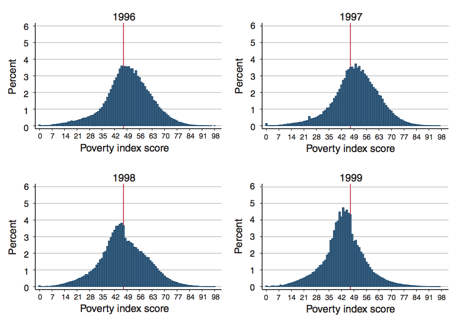
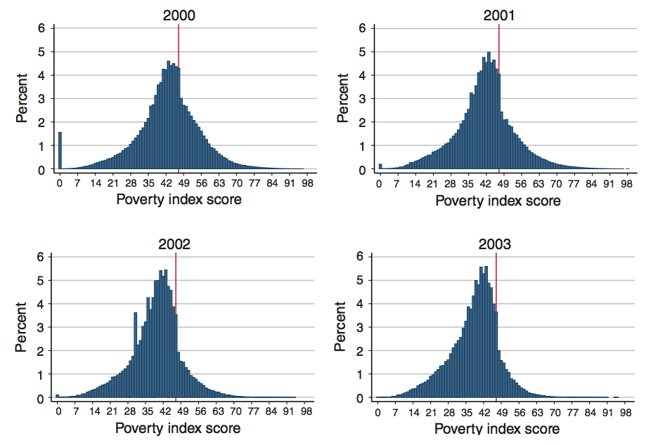

layout: true

<div class="my-footer"></div> 

---

```{r setup, include=FALSE,warning=FALSE,message=FALSE}
options(htmltools.dir.version = FALSE)
knitr::opts_chunk$set(
  message = FALSE,
  warning = FALSE,
  dev = "svg",
  cache = TRUE,
  fig.align = "center"
  #fig.width = 11,
  #fig.height = 5
)

# définir les variables
om = par("mar")
lowtop = c(om[1],om[2],0.1,om[4])

overwrite = FALSE

library(tidyverse)
library(ggplot2)
library(grid)
library(pBrackets) 
library(emo)
library(viridis)

  # fixer la graine aléatoire
set.seed(1234)

```

layout: true

<div class="my-footer"></div> 

---

# Rappel de la semaine dernière

* Méthode d'évaluation de politiques par ***différences de différences***

* Équation d'estimation principale :
$$Y_{it} = \alpha + \beta TREAT_i + \gamma POST_t + \delta(TREAT_i \times POST_t) + \varepsilon_{it}$$

* Hypothèse clé : ***tendances parallèles***

--

## Aujourd'hui : ***Régression sur discontinuité***

* La vie est pleine de règles arbitraires qui assignent un traitement

* Exploite la connaissance de la règle d'assignation

* Hypothèse clé : la variable qui assigne le traitement ne peut pas être manipulée par les individus

* *Application empirique :* effet de la consommation d'alcool sur la mortalité

---

# Régression sur discontinuité (RDD)

* Stratégie de recherche très courante en recherche appliquée car elle fournit des estimations causales crédibles.

--

* Point de départ : les sujets ne sont ***pas*** assignés aléatoirement au traitement `r emo::ji("warning")`

--

* La RDD peut être appliquée lorsque nous disposons d'informations précises sur les règles qui déterminent le traitement.

--

* La __RDD__ exploite cette information précise sur l'assignation au traitement !

---

# Les discontinuités sont partout

Il existe de nombreuses règles arbitraires qui déterminent l'assignation à un traitement :
  
--
  
* En Caroline du Nord, il fallait avoir cinq ans avant le 16 octobre de l'année concernée pour pouvoir entrer à la maternelle [(Cook et Kang, 2016)](https://pubs.aeaweb.org/doi/pdfplus/10.1257/app.20140323);
  
--
  
* Aux États-Unis, un nouveau-né pesant moins de 1 500 grammes est considéré comme de « très faible poids de naissance » et reçoit des soins supplémentaires [(Almond et al., 2010)](https://academic.oup.com/qje/article/125/2/591/1882183);
  
--

* Les universités publiques phares utilisent un seuil de score au SAT pour sélectionner leurs étudiants [(Hoekstra, 2009)](https://cdn.theatlantic.com/static/mt/assets/business/Hoekstra_Flagship.pdf);

--

* En Italie, il existe des quotas de permis de séjour pour les immigrés illégaux, attribués selon le principe du premier arrivé, premier servi jusqu'à épuisement du quota [(Pinotti, 2017)](https://pubs.aeaweb.org/doi/pdfplus/10.1257/aer.20150355);

--

Nous nous concentrerons sur la discontinuité suivante :

* Aux États-Unis, l'âge légal pour boire de l'alcool est de 21 ans [(Carpenter et Dobkin, 2009)](http://masteringmetrics.com/wp-content/uploads/2015/01/Carpenter-and-Dobkin-2009.pdf).

---

# Un exemple : consommation d'alcool et mortalité

--

* Imaginons que vous souhaitiez évaluer l'impact __causal__ de la consommation d'alcool des jeunes adultes sur la mortalité.

--

* Pourquoi n'est-ce pas si simple ? Pourquoi ne pas simplement régresser la consommation d'alcool sur l'âge et la cause du décès ?

--

  * Parce qu'il peut exister une sélection non observée dans la consommation d'alcool, qui peut aussi être un déterminant de la mortalité.
  
--

* Aux États-Unis, la consommation d'alcool est interdite avant l'âge de 21 ans.

--

* Il existe un débat sur l'opportunité d'abaisser l'âge légal minimum pour boire (MLDA, *minimum legal drinking age*) à 18 ans, comme à l'époque de la guerre du Vietnam.

---

# Termes clés et intuition

> ***Variable d'assignation*** (*running variable*) : variable qui détermine l'assignation au traitement.

--

$\rightarrow$ $a$ = age

--

> ***Seuil*** (*cutoff*) : niveau de la ***variable d'assignation*** au-dessus (ou en dessous) duquel les individus sont traités (ou non).

--

$\rightarrow$ $c = 21$ ans (21e anniversaire)

--

Intuition causale :

* En quoi les individus *juste avant* et *juste après* leur 21e anniversaire diffèrent-ils, à part l'accès légal à l'alcool ?

--

* Autour du seuil, l'assignation au traitement est ***quasi aléatoire***.

--

* `r emo::ji("point_right")` La ***régression sur discontinuité*** exploite cette assignation au traitement !

---

# Les données de Carpenter et Dobkin

* Regardons de plus près les données utilisées dans l'article

.pull-left[
```{r, echo = TRUE, eval = TRUE}
# installer le package contenant les données
devtools::install_github("jrnold/masteringmetrics",
                         subdir = "masteringmetrics")

# charger le package
library(masteringmetrics)
# charger les données
data("mlda", package = "masteringmetrics")
```
]

--

.pull-right[
```{r, echo = FALSE}
mlda %>%
  select(agecell, all, internal, external,
         alcohol, homicide, suicide) %>%
  head()
```
]

--

* Ce jeu de données contient des taux de mortalité agrégés (et leurs causes) pour différents groupes d'âge (`agecell`) entre 19 et 23 ans.

---

# Discontinuité nette au seuil

```{r, echo = FALSE, eval = TRUE, fig.height = 4.75, fig.width = 10}
mlda <- mlda %>%
  mutate(over21 = (agecell >= 21))

rdd_run <- mlda %>%
  ggplot(aes(x = agecell, y = over21, color = over21)) +
  geom_point(size = 4, alpha = 0.8) +
  geom_vline(xintercept = 21, linetype = "longdash") +
  labs(x = "Âge", y = "Au-dessus de l'âge légal (MLDA)") +
  scale_color_viridis_d() +
  theme_bw(base_size = 14) + theme(legend.position="none")
rdd_run
```

Au seuil, la probabilité d'être traité passe brusquement de 0 à 1.

---

# Discontinuité nette au seuil

```{r, echo = FALSE, eval = TRUE, fig.height = 4.75, fig.width = 10}
rdd_run +
  annotate("rect", xmin = 20.5, xmax = 21.5, ymin = -Inf, ymax = Inf, alpha = .2) +
  annotate("rect", xmin = 21 - 1/12, xmax = 21 + 1/12, ymin = -Inf, ymax = Inf, alpha = .4) +
  geom_point(size = 4, alpha = 0.8) +
  geom_vline(xintercept = 21, linetype = "longdash")
```

---

# Discontinuité nette au seuil

```{r, echo = FALSE, eval = TRUE, fig.height = 4.75, fig.width = 10}
rdd_run +
  annotate("rect", xmin = 20.5, xmax = 21.5, ymin = -Inf, ymax = Inf, alpha = .2) +
  annotate("rect", xmin = 21 - 1/12, xmax = 21 + 1/12, ymin = -Inf, ymax = Inf, alpha = .4) +
  geom_point(size = 4, alpha = 0.8) +
  geom_vline(xintercept = 21, linetype = "longdash") +
  scale_x_continuous(breaks = c(21 - 6/12, 21 - 3/12, 21, 21 + 3/12, 21 + 6/12),
                     labels = c("- 6 mois", "- 3 mois", "21", "+ 3 mois", "+ 6 mois"),
                     minor_breaks = seq(from = 21 - 7/12, to = 21 + 7/12, by = 1/12),
                     lim = c(21 - 7/12, 21 + 7/12))
```

---

# Le cadre de la RDD

* ***Variable de traitement*** : $D_a$

--

  - $D_a$ = 1 si l'individu a plus de 21 ans, $D_a$ = 0 sinon.

--

  - $D_a$ est une fonction de l'âge de l'individu, $a$, qui est la ***variable d'assignation***.
  
--

* L'âge ***seuil***, 21 ans, sépare ceux qui peuvent boire légalement de ceux qui ne le peuvent pas :
  $$
  D_a = \begin{cases}\begin{array}{lcl}
  1 \quad \text{si } a \geq 21 \\\
  0 \quad \text{si } a < 21
  \end{array}\end{cases}
  $$
  
## Caractéristiques clés des designs RD

1. Le statut de traitement est une fonction __déterministe__ de $a$ $\rightarrow$ nous connaissons la règle d'assignation

--

1. Le statut de traitement est une fonction __discontinue__ de $a$ $\rightarrow$ il existe un seuil

---

class: inverse

# Exercice 1 (10 minutes)

1. Importez le jeu de données en suivant le code de la slide 7. Combien y a-t-il de cellules d'âge ?

1. Créez une variable dummy pour les individus de plus de 21 ans.

1. Représentez le taux de mortalité toutes causes confondues (`all`) en fonction de l'âge (`agecell`) en colorant différemment les observations au-dessus et en dessous de 21 ans. Quelque chose vous frappe-t-il ?

1. Ajoutez une droite de régression au graphique. Qu'observez-vous ?

1. Faites de même pour les causes liées aux véhicules à moteur (`mva`) et à l'alcool (`alcohol`) en fonction de l'âge.

---

# Résultats graphiques : taux de mortalité toutes causes

```{r, echo = FALSE, eval = TRUE, fig.height = 5, fig.width = 10}
rdd_plot <- mlda %>%
  ggplot(aes(x = agecell, y = all, color = over21)) +
  geom_point(size = 4) +
  geom_vline(xintercept = 21, linetype = "longdash") +
  labs(x = "Âge",
       y = "Taux de mortalité toutes causes (pour 100 000)",
       color = NULL) +
  scale_colour_viridis_d(aesthetics = c("colour", "fill"), labels = c("FALSE" = "Contrôle", "TRUE" = "Traitement")) +
  theme_bw(base_size = 14) +
  theme(legend.position="none")
rdd_plot
```

---

# Résultats graphiques : taux de mortalité toutes causes

```{r, echo = FALSE, eval = TRUE, fig.height = 5, fig.width = 10}
library(broom)
all_fit <- augment(lm(all ~ agecell + over21, mlda))

rdd_plot_line <- rdd_plot +
  geom_line(data = all_fit %>% filter(agecell < 21), aes(x = agecell, y = .fitted), color = viridis_pal()(2)[1], size = 2) +
  geom_line(data = all_fit %>% filter(agecell >= 21), aes(x = agecell, y = .fitted), color = viridis_pal()(2)[2], size = 2) +
labs(fill = NULL)
rdd_plot_line
```

---

# Résultats graphiques : taux de mortalité toutes causes

```{r, echo = FALSE, eval = TRUE, fig.height = 5, fig.width = 10}
bracketsGrob <- function(...){
l <- list(...)
e <- new.env()
e$l <- l
  grid:::recordGrob(  {
    do.call(grid.brackets, l)
  }, e)
}

b1 <- bracketsGrob(21, all_fit$.fitted[all_fit$agecell < 21 & all_fit$agecell > 20.9], 21, all_fit$.fitted[all_fit$agecell > 21 & all_fit$agecell <= 21.1],
                   h = 0.75, lwd=1.5, col="black")

rdd_plot_line_brack <- rdd_plot_line +
  annotation_custom(b1,xmin= 0, xmax=1, ymin=0, ymax=1) +
  annotate("text", x = 20.65, y = 96, label = "Effet du\ntraitement", colour = "black", size = 5)
rdd_plot_line_brack
```

---

# Résultats graphiques : taux de mortalité toutes causes

```{r, echo = FALSE, eval = TRUE, fig.height = 5, fig.width = 10}
bracketsGrob <- function(...){
l <- list(...)
e <- new.env()
e$l <- l
  grid:::recordGrob(  {
    do.call(grid.brackets, l)
  }, e)
}

all_fit_2 <- augment(lm(all ~ agecell + over21, mlda %>% filter(agecell >= 20.4 & agecell <= 21.6)))

b1 <- bracketsGrob(21, all_fit_2$.fitted[all_fit_2$agecell < 21 & all_fit_2$agecell > 20.9], 21, all_fit_2$.fitted[all_fit_2$agecell > 21 & all_fit_2$agecell <= 21.1],
                   h = 0.75, lwd=1.5, col="black")

rdd_plot +
  geom_line(data = all_fit_2 %>% filter(agecell < 21), aes(x = agecell, y = .fitted), color = viridis_pal()(2)[1], size = 2) +
  geom_line(data = all_fit_2 %>% filter(agecell >= 21), aes(x = agecell, y = .fitted), color = viridis_pal()(2)[2], size = 2) +
  labs(fill = NULL) +
  annotation_custom(b1,xmin= 0, xmax=1, ymin=0, ymax=1) +
  annotate("text", x = 20.9, y = 97.2, label = "Effet du\ntraitement", colour = "black", size = 5) +
  scale_x_continuous(breaks = c(21 - 6/12, 21 - 3/12, 21, 21 + 3/12, 21 + 6/12),
                     labels = c("- 6 mois", "- 3 mois", "21", "+ 3 mois", "+ 6 mois"),
                     minor_breaks = seq(from = 21 - 7/12, to = 21 + 7/12, by = 1/12),
                     lim = c(21 - 7/12, 21 + 7/12))
```

---

# La RDD comme effet moyen local du traitement (LATE)

* L'estimateur RD est un __effet moyen local du traitement (LATE)__.

--

* Il ne vous renseigne que sur l'impact du traitement $D$ sur le résultat $Y$ ***autour*** de la valeur seuil de la variable d'assignation.

--

* ***Validité externe*** limitée $\rightarrow$ on ne peut pas extrapoler à l'ensemble de la population.

--

* Utiliser l'âge légal de 21 ans pour l'alcool dans un contexte RD ne vous donnera que l'effet de cette restriction sur les taux de mortalité, mais pas l'effet général de la consommation d'alcool.

--

* On peut facilement soutenir que tous les résultats des analyses empiriques quantitatives ont un caractère local.

---

layout: false
class: title-slide-section-red, middle

# Estimation

---

layout: true

<div class="my-footer"></div> 

---

# Estimation

* *Objectif :* mesurer l'***écart*** entre les deux droites au seuil.

--

* Dans sa forme la plus simple, on peut écrire le modèle de régression suivant :
    $$DEATHRATE_a = \alpha + \delta D_a + \beta a + \varepsilon_i,$$
  où $DEATHRATE_a$ est le taux de mortalité à l'âge $a$, $D_a$ est la dummy de traitement, et $a$ est l'âge (défini en mois par rapport au 21e anniversaire).

--

  $\rightarrow$ $\delta$ capte le **saut du taux de mortalité** entre les individus au-dessus et en dessous de 21 ans.

--

* L'estimateur RDD exploite une discontinuité en $a = 21$ dans la fonction d'espérance conditionnelle :
$$\underbrace{\lim_{c \to 21^+} \mathbb{E}[DEATHRATE_a|a = c]}_{\alpha + \delta} - \underbrace{\lim_{c \to 21^-} \mathbb{E}[DEATHRATE_a|a = c]}_{\alpha} = \delta$$

---

class: inverse

# Exercice 2 (5 minutes)

1. Estimez le modèle suivant sur toutes les causes de décès.
$$DEATHRATE_a = \alpha + \delta D_a + \beta a + \varepsilon_i,$$

 Le coefficient RDD correspond-il à l'illustration graphique ?
 
1. Comment interprétez-vous chaque coefficient ?

1. Quel est l'effet causal de l'accès légal à l'alcool sur les taux de mortalité ?

---

# Estimation n°1 : modèle linéaire simple

$$DEATHRATE_a = \alpha + \delta D_a + \beta a + \varepsilon_a,$$

.pull-left[
```{r, eval = FALSE}
mlda <- mlda %>%
  mutate(over21 = (agecell >= 21),
         agecell_21 = agecell - 21)
rdd <- lm(all ~ agecell_21 + over21, mlda)

library(broom)
tidy(rdd)
```
]

.pull-right[
```{r, echo = FALSE}
mlda <- mlda %>%
  mutate(over21 = (agecell >= 21),
         agecell_21 = agecell - 21)
rdd <- lm(all ~ agecell_21 + over21, mlda)

library(broom)
tidy(rdd)
```
]

--

<br>

***Interprétation :***

--

En moyenne, la MLDA augmente les taux de mortalité toutes causes confondues de 7,66 points de pourcentage.

--

C'est un effet important compte tenu du taux de mortalité moyen des individus entre 19 et 22 ans, qui est de :

```{r}
mean(mlda$all, na.rm = TRUE)
```


---

# Problèmes d'estimation

* La ***forme fonctionnelle*** utilisée pour approximer les droites compte vraiment !

--

   $\rightarrow$ une spécification insuffisamment flexible risque de confondre une non-linéarité avec un effet du traitement ;

--
   
   $\rightarrow$ une spécification trop flexible réduit la précision et risque le surajustement (*overfitting*).


---

# Simulations - relation linéaire et discontinuité nette

```{r, echo = FALSE, fig.height = 4.5, fig.width = 10}
set.seed(1234)

  # paramètres
cutoff = 0.5
alpha = 0.2 # constante
delta = 0.4 # saut au seuil
beta = 2 # pente
nsim = 150 # nombre d'observations simulées

  # variable d'assignation
x = runif(n = nsim,
          min = 0,
          max = 1)

  # variable de traitement
D = if_else(x > cutoff, TRUE, FALSE)

  # terme d'erreur
u = rnorm(n = nsim, mean = 0, sd = .1)

  # variable de résultat
Y = alpha + beta * x + D*delta + u

  # créer le tibble
rdd_sim = tibble(running = x,
                 treatment_dum = D,
                 outcome = Y)
  
  # graphique
rdd_lin <- ggplot(rdd_sim,
       aes(x = running, y = outcome, color = treatment_dum)) +
  geom_point(size = 3, alpha = 0.75) +
  stat_smooth(method = "lm", se = FALSE) +
  ylim(0,3) +
  labs(x = "Variable d'assignation",
       y = "Variable de résultat",
       colour = NULL) +
  scale_colour_viridis_d(breaks=c("FALSE", "TRUE"), labels = c("Non traité", "Traité")) +
  theme_bw(base_size = 14) + theme(legend.position="top")
rdd_lin
```

--

$$outcome_i = \alpha + \delta treatment_i + \beta running_i + e_i,$$

---

# Simulations - relation linéaire et discontinuité nette

```{r, echo = FALSE, fig.height = 4.5, fig.width = 10}
bracketsGrob <- function(...){
l <- list(...)
e <- new.env()
e$l <- l
  grid:::recordGrob(  {
    do.call(grid.brackets, l)
  }, e)
}

b1 <- bracketsGrob(0.50, 1.20, 0.50, 1.63, h = 0.2, lwd=1.5, col="black")

rdd_lin +
  annotation_custom(b1,xmin= 0, xmax=1, ymin=0, ymax=1) +
  annotate("text", x = 0.46, y = 1.45, label = "delta", colour = "#d90502", parse = T, size = 8)
```

$$outcome_i = \alpha + \color{#d90502}\delta treatment_i + \beta running_i + e_i,$$

---

# Simulations - relation quadratique et discontinuité nette

```{r, echo = FALSE, fig.height = 4.5, fig.width = 10}
set.seed(1234)

  # paramètres
cutoff = 0.5
alpha = 1.5 # constante
delta = 0.4 # saut au seuil
beta = -8 # pente
beta_2 = 25
beta_3 = -17
nsim = 150 # nombre d'observations simulées

  # variable d'assignation
x = runif(n = nsim,
          min = 0,
          max = 1)

  # variable de traitement
D = if_else(x > cutoff, TRUE, FALSE)

  # terme d'erreur
u = rnorm(n = nsim, mean = 0, sd = .1)

  # variable de résultat
Y = alpha + beta * x + beta_2 * x^2 + beta_3 * x^3 + D*delta + u

  # créer le tibble
rdd_sim = tibble(running = x,
                 treatment_dum = D,
                 outcome = Y)

  # graphique
rdd_quad <- ggplot(rdd_sim,
       aes(x = running, y = outcome, color = treatment_dum)) +
  geom_point(size = 3, alpha = 0.75) +
  stat_smooth(method = "lm",
              formula = y ~ x + I(x^2),
              se = FALSE) +
  geom_vline(xintercept = 0.5, linetype = "longdash") +
  ylim(0,3) +
  labs(x = "Variable d'assignation", y = "Variable de résultat", colour = "") +
  scale_colour_viridis_d(breaks=c("FALSE", "TRUE"), labels = c("Non traité", "Traité")) +
  theme_bw(base_size = 14) + theme(legend.position="top")
rdd_quad
```

--

$$outcome_i = \alpha + \delta treatment_i + \beta_1 running_i + \color{#d90502}{\beta_2 running_i^2} + e_i,$$

---

# Simulations - relation quadratique et discontinuité nette

```{r, echo = FALSE, fig.height = 4.5, , fig.width = 10}
bracketsGrob <- function(...){
l <- list(...)
e <- new.env()
e$l <- l
  grid:::recordGrob(  {
    do.call(grid.brackets, l)
  }, e)
}

b1 <- bracketsGrob(0.50, 1.68, 0.50, 2.05, h = 0.2, lwd=1.5, col="black")

rdd_quad +
  annotation_custom(b1,xmin= 0, xmax=1, ymin=0, ymax=1) +
  annotate("text", x = 0.46, y = 1.865, label = "delta", colour = "#d90502", parse = T, size = 8)
```

$$outcome_i = \alpha + \color{#d90502}\delta treatment_i + \beta_1 running_i + \beta_2 running_i^2 + e_i,$$

---

# Simulations - relation linéaire mais SANS discontinuité

```{r, echo = FALSE, fig.height = 4.5, fig.width = 10}
set.seed(123)

  # paramètres
cutoff = 0.5
alpha = 2.5 # constante
beta_1 = 2.5 # pente
beta_2 = 0.5 # pente 2
power = 7
nsim = 150 # nombre d'observations simulées

  # variable d'assignation
x = runif(n = nsim,
          min = 0,
          max = 1)

  # variable de traitement
D = if_else(x > cutoff, TRUE, FALSE)

  # terme d'erreur
u = rnorm(n = nsim, mean = 0, sd = .1)

  # variable de résultat
Y = alpha + (1 - alpha) / (1 + (x/beta_2)^power) + u

  # sans terme d'erreur
Y_true = alpha + (1 - alpha) / (1 + (x/beta_2)^power)

  # créer le tibble
rdd_sim = tibble(running = x,
                 treatment_dum = D,
                 outcome = Y,
                 true = Y_true)

  # graphique
rdd_nodisc <- ggplot(rdd_sim,
       aes(x = running, y = outcome, color = treatment_dum)) +
  geom_point(size = 3, alpha = 0.75) +
  geom_line(aes(x = running, y = true), colour = "black", linetype = "dotted") +
  stat_smooth(method = "lm",
              formula = y ~ x,
              se = FALSE) +
  geom_vline(xintercept = 0.5, linetype = "longdash") +
  ylim(0,3) +
  labs(x = "Variable d'assignation", y = "Variable de résultat", colour = "") +
  scale_colour_viridis_d(breaks=c("FALSE", "TRUE"), labels = c("Non traité", "Traité")) +
  theme_bw(base_size = 14) + theme(legend.position="top")
rdd_nodisc
```

---

# Simulations - pentes différentes

```{r, echo = FALSE, fig.height = 4.5, fig.width = 10}
set.seed(1234)

  # paramètres
cutoff = 0.5
alpha = 1 # constante
delta = 0.4 # saut au seuil
beta = -1 # pente
gamma = 4
nsim = 150 # nombre d'observations simulées

  # variable d'assignation
x = runif(n = nsim,
          min = 0,
          max = 1)

  # variable de traitement
D = if_else(x > cutoff, TRUE, FALSE)

  # terme d'erreur
u = rnorm(n = nsim, mean = 0, sd = .1)

  # variable de résultat
Y = alpha + beta * (x - cutoff) + D*delta + gamma * D * (x - cutoff) + u

  # créer le tibble
rdd_sim = tibble(running = x,
                 treatment_dum = D,
                 outcome = Y)

  # graphique
rdd_diffslope <- ggplot(rdd_sim,
       aes(x = running, y = outcome, color = treatment_dum)) +
  geom_point(size = 3, alpha = 0.75) +
  stat_smooth(method = "lm",
              formula = y ~ x,
              se = FALSE) +
  geom_vline(xintercept = 0.5, linetype = "longdash") +
  ylim(0,3) +
  labs(x = "Variable d'assignation", y = "Variable de résultat", colour = "") +
  scale_colour_viridis_d(breaks=c("FALSE", "TRUE"), labels = c("Non traité", "Traité")) +
  theme_bw(base_size = 14) + theme(legend.position="top")
rdd_diffslope
```

--

$$outcome_i = \alpha + \delta treatment_i + \beta (running_i - cutoff) + \\ \color{#d90502}{\gamma treatment_i * (running_i - cutoff)} + e_i,$$

---

# Simulations - pentes (linéaires) différentes

```{r, echo = FALSE, fig.height = 4.5, fig.width = 10}
bracketsGrob <- function(...){
l <- list(...)
e <- new.env()
e$l <- l
  grid:::recordGrob(  {
    do.call(grid.brackets, l)
  }, e)
}

b1 <- bracketsGrob(0.50, 0.99, 0.50, 1.46, h = 0.2, lwd=1.5, col="black")

rdd_diffslope +
  annotation_custom(b1,xmin= 0, xmax=1, ymin=0, ymax=1) +
  annotate("text", x = 0.46, y = 1.225, label = "delta", colour = "#d90502", parse = T, size = 8)
```

$$outcome_i = \alpha + \color{#d90502}\delta treatment_i + \beta (running_i - cutoff) + \\ \gamma treatment_i * (running_i - cutoff) + e_i,$$

---

# Comment choisir la forme fonctionnelle appropriée ?

* Il est essentiel de __visualiser__ les données !

--

* Les coefficients ne devraient pas trop varier d'un modèle à l'autre.

--

* Doit-on s'attendre à ce que la relation entre la variable de résultat et la variable d'assignation soit non linéaire ? Doit-on s'attendre à ce qu'elle diffère autour du seuil ?

--

* [Gelman et Imbens (2019)](https://www.tandfonline.com/doi/abs/10.1080/07350015.2017.1366909), « Why High-Order Polynomials Should Not Be Used in Regression Discontinuity Designs » :  
  *« Nous recommandons aux chercheurs [...] d'utiliser des estimateurs fondés sur des polynômes locaux linéaires ou quadratiques, ou d'autres fonctions lisses. »* (traduction libre)

---

# Retour à notre exemple : non-linéarités / pentes $\neq$ ?

```{r, echo = FALSE, eval = TRUE, fig.height = 4.5, fig.width = 10}
all_nonlin_fit <- augment(lm(all ~ agecell_21*over21 + I(agecell_21^2)*over21, mlda))

rdd_plot
```

---

# Retour à notre exemple : non-linéarités / pentes $\neq$ ?

```{r, echo = FALSE, eval = TRUE, fig.height = 4.5, fig.width = 10}
all_nonlin_fit <- augment(lm(all ~ agecell_21*over21 + I(agecell_21^2)*over21, mlda))

rdd_plot_line +
  geom_line(data = all_nonlin_fit %>% filter(agecell_21 < 0), aes(x = agecell_21 + 21, y = .fitted), color = viridis_pal()(2)[1], linetype = "dashed", size = 1.25) +
  geom_line(data = all_nonlin_fit %>% filter(agecell_21 >= 0), aes(x = agecell_21 + 21, y = .fitted), color = viridis_pal()(2)[2], linetype = "dashed", size = 1.25)
```

--

L'écart entre les droites est à peu près le même pour les deux spécifications.
---

class: inverse

# Exercice 3 (15 minutes)

1. Estimez le modèle *quadratique* suivant sur toutes les causes de décès. Le coefficient RDD diffère-t-il de celui du modèle linéaire ? 
$$DEATHRATE_a = \alpha + \delta D_a + \beta a + \beta a^2 + \varepsilon_a,$$

1. Rappel : le modèle de régression permettant des pentes différentes de chaque côté du seuil est :
$$DEATHRATE_a = \alpha + \delta D_a + \beta (a - 21) + \gamma D_a * (a - 21) + \varepsilon_a,$$
   - Pourquoi doit-on soustraire le `cutoff` (seuil) de `running_i` ? (Indice : calculez $\mathbb{E}(DEATHRATE_a|a=21)$)
   - Doit-on s'attendre à ce que la relation entre les taux de mortalité et l'âge change à 21 ans ?
   - Estimez ce modèle. En quoi le coefficient RDD diffère-t-il de ceux des autres modèles estimés ?

* Ré-estimez ces modèles (linéaire, quadratique, pentes différentes) pour les causes de décès suivantes : accidents de véhicules à moteur (`mva`), liées à l'alcool (`alcohol`) et internes (`internal`).

---

# Représentation graphique des résultats de la régression

```{r, echo = FALSE, eval = TRUE, fig.height = 5, fig.width = 10}
mlda_long <- mlda %>%
    select(-contains("fitted")) %>%        # supprimer les variables « fitted »
    pivot_longer(cols = -c(agecell,over21),          # colonnes à ne pas remodeler
                 names_to = "death_cause", # nouvelle variable contenant les causes de décès
                 values_to = "death_rate") %>% # nouvelle variable contenant les taux de mortalité par cause
  filter(death_cause %in% c("all","mva","internal"))

rdd_plot <- mlda_long %>%
  ggplot(aes(x = agecell, y = death_rate, color = over21)) + geom_point() +
    geom_smooth(mapping = aes(group = over21), se = FALSE, method = "lm",
              formula = y ~ x) +
  geom_vline(xintercept = 21, linetype = "longdash") +
  labs(x = "Âge", y = "Taux de mortalité (pour 100 000)") +
  scale_colour_viridis_d() +
  theme_bw(base_size = 16) + theme(legend.position="none") +
  facet_grid(rows = vars(death_cause), scales = "free_y")
rdd_plot
```

---

# Estimation non paramétrique

* Donner plus de poids aux observations proches du seuil

--

2 paramètres :

  * Combien de poids en plus ?

--
  
  $\rightarrow$ dépend du ***noyau*** (*kernel*) choisi.

--

  * À quelle distance du seuil les observations doivent-elles se trouver pour être écartées ?
  
--

  $\rightarrow$ dépend de la ***fenêtre*** (*bandwidth*) choisie.
  
--

Heureusement, il existe un package `R` qui choisit ces paramètres de façon optimale grâce à des algorithmes sophistiqués : `rdrobust`.

---

layout: false
class: title-slide-section-red, middle

# Hypothèses d'identification

---

layout: true

<div class="my-footer"></div> 

---

# Hypothèses de la RDD

> *Hypothèse clé* : ***les résultats potentiels sont continus (lisses) au seuil.***

--

$\rightarrow$ la variable d'assignation ne peut pas être manipulée !

--

Formellement :

$$\lim_{r \to c+} E[Y_i^d|r] = \lim_{r \to c-} E[Y_i^d|r], d \in \{0,1\}$$

--

* La population juste en dessous ne doit pas être discrètement différente de la population juste au-dessus du seuil.

--

* L'hypothèse est violée si les individus peuvent manipuler la variable d'assignation parce qu'ils connaissent la valeur du seuil.

--

  * Connaître la valeur du seuil ne viole pas en soi l'hypothèse ; seule la capacité à manipuler la variable d'assignation la viole.

---

# Hypothèses de la RDD

> *Hypothèse clé* : ***les résultats potentiels sont continus (lisses) au seuil.***

Si l'hypothèse est vérifiée, nous avons :

$$
\begin{align}
&\lim_{r \to c^+} \mathbb{E}[Y_i | R_i = r] - \lim_{r \to c^-} \mathbb{E}[Y_i | R_i = r] \\
= &\lim_{r \to c^+} \mathbb{E}[Y_i^1 | R_i = r] - \lim_{r \to c^-} \mathbb{E}[Y_i^0 | R_i = r] \\
= &\mathbb{E}[Y_i^1 | R_i = c] - \mathbb{E}[Y_i^0 | R_i = c] \\
= &\mathbb{E}[Y_i^1 - Y_i^0 | R_i = c] \\
\end{align}
$$

---

# Hypothèses de la RDD

> *Hypothèse clé* : ***les résultats potentiels sont continus (lisses) au seuil.***

Si l'hypothèse est vérifiée, nous avons :

$$
\begin{align}
&\lim_{c \to 21^+} \mathbb{E}[Y_i | a_i = c] - \lim_{a \to 21^-} \mathbb{E}[Y_i | a_i = c] \\
= &\lim_{c \to 21^+} \mathbb{E}[Y_i^1 | a_i = c] - \lim_{c \to 21^-} \mathbb{E}[Y_i^0 | a_i = c] \\
= &\mathbb{E}[Y_i^1 | a_i = 21] - \mathbb{E}[Y_i^0 | a_i = 21] \\
= &\underbrace{\mathbb{E}[Y_i^1 - Y_i^0}_\text{ATE} | a_i = 21] \\
\end{align}
$$

---

# Exemple de manipulation : [Camacho et Conover (2011)](https://pubs.aeaweb.org/doi/pdfplus/10.1257/pol.3.2.41)

Que se passe-t-il lorsque le seuil d'éligibilité aux programmes d'aide sociale devient connu ?

.pull-left[
```{r, echo = FALSE, out.width = "700px"}

```
]

--

.pull-right[
```{r, echo = FALSE, out.width = "700px"}

```
]
---

# Non-respect de l'assignation

Et si la variable d'assignation ne détermine pas *entièrement* l'assignation au traitement ?

$\rightarrow$ ***RDD floue*** (*fuzzy RDD*)

* Même si toutes les observations qui satisfont la condition de traitement ne sont pas traitées, il y a toujours un saut dans la probabilité d'être traité.

* Pour vous, retenez simplement que le problème d'une détermination imparfaite de l'assignation au traitement peut tout de même être résolu

---

# 5 étapes pour mener une RDD en pratique<sup>1</sup>

.footnote[
<sup>1</sup> Tiré de l'excellent cours d'[Andrew Heiss sur la RDD](https://evalsp20.classes.andrewheiss.com/class/11-class/).
]

### Étape n°1 : ***L'assignation au traitement repose-t-elle sur une règle ?***

--

### Étape n°2 : ***Le design est-il net ou flou ?***

--

### Étape n°3 : ***Y a-t-il une discontinuité de la variable d'assignation au seuil ?***

--

### Étape n°4 : ***Y a-t-il une discontinuité de la variable de résultat au seuil de la variable d'assignation ?***

--

### Étape n°5 : ***Quelle est l'ampleur de l'écart ?***

---

class: title-slide-final, middle
background-image: url(../img/logo/namur-logo.png)
background-size: 250px
background-position: 9% 19%

# BONNE JOURNÉE !


|                                                                                                            |                                   |
| :--------------------------------------------------------------------------------------------------------- | :-------------------------------- |
| <a href="mailto:jeremy.donascimento@unamur.be">.Namurgreen[<i class="fa fa-paper-plane fa-fw"></i>]               | jeremy.donascimento@unamur.be       |
| <a href="https://discord.gg/RcdCRFBcc">.Namurgreen[<i class="fab fa-link fa-fw"></i></a>] | Discord |
| <a href="https://github.com/jdnmiguel/econometric_ECGEB352">.Namurgreen[<i class="fa fa-link fa-fw"></i>] | Slides |