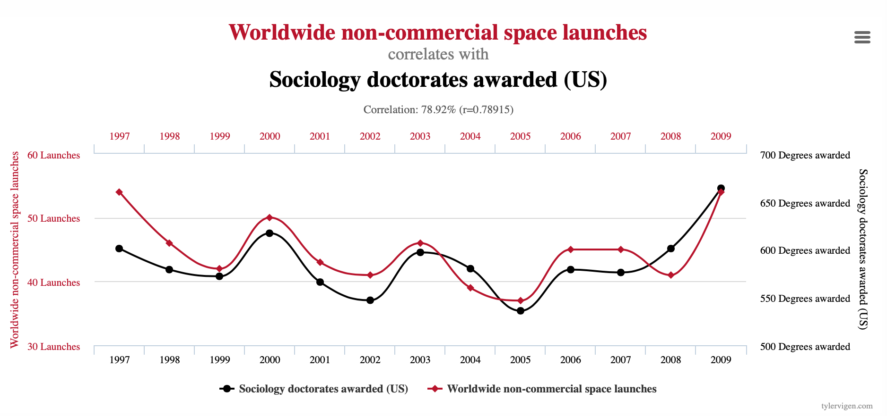
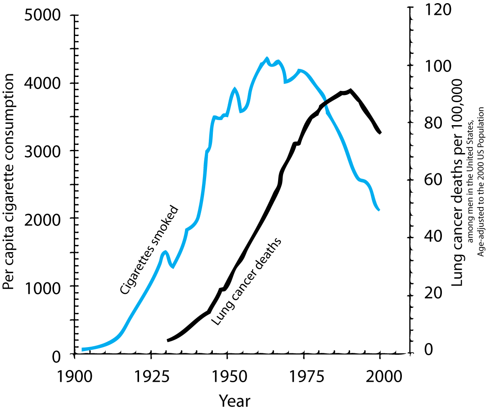
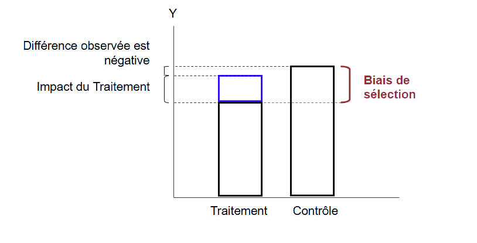
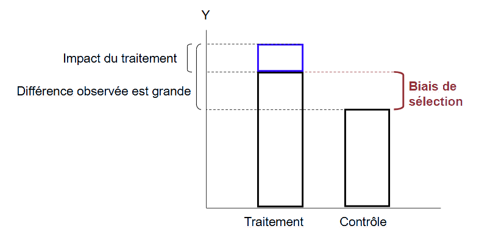

layout: true

<div class="my-footer"></div> 

---

```{r setup, include=FALSE,warning=FALSE,message=FALSE}
options(htmltools.dir.version = FALSE)
knitr::opts_chunk$set(
  message = FALSE,
  warning = FALSE,
  dev = "svg",
  cache = TRUE,
  fig.align = "center"
  #fig.width = 11,
  #fig.height = 5
)

# définir les variables
om = par("mar")
lowtop = c(om[1],om[2],0.1,om[4])

overwrite = FALSE

library(tidyverse)
library(ggplot2)
library(emo)
library(dplyr)
library(png)
library(grid)
library(pander)
library(countdown)

# countdown style
countdown(
  color_border              = "forestgreen",
  color_text                = "black",
  color_running_background  = "forestgreen",
  color_running_text        = "white",
  color_finished_background = "white",
  color_finished_text       = "forestgreen",
  color_finished_border     = "forestgreen"
)
```

layout: true

<div class="my-footer"></div> 

---

# Aujourd'hui - Introduction à l'inférence causale

* ***Causalité*** versus ***corrélation***

* Le ***cadre des résultats potentiels*** (*Potential Outcomes Framework*), alias modèle causal de Rubin

* Les ***essais contrôlés randomisés*** (RCT)

* Suite de l'application empirique sur la *taille des classes* et la *performance des élèves*

---

# Causalité et économie

- Faire de l'inférence causale à partir de données peut être vu comme l'*avantage comparatif* des économistes parmi les sciences sociales !

- De nombreuses disciplines font des statistiques. Mais très peu intègrent dans la formation standard de leurs étudiants la compréhension de la causalité.

- L'effort des économistes pour établir des relations causales est aussi ce qui les rend utiles tant dans le secteur privé (p. ex. les entreprises technologiques) que dans le secteur public (p. ex. les conseillers en politiques publiques). 

--

- Bon, assez de sermon `r emo::ji("sweat_smile")`


---

# Le concept de causalité

__Causalité__ : de quoi parle-t-on ? 

- On dit que `X` *cause* `Y`

--

  - si l'on intervenait et *changeait* la valeur de `X` ***sans rien changer d'autre***...
    
--

  - alors `Y` changerait aussi ***en conséquence***.
  
--

- Le point clé ici est le ***sans rien changer d'autre***, souvent appelé l'**hypothèse *ceteris paribus* (*toutes choses égales par ailleurs*)**.   
(*le latin* donne l'impression que tout est plus compliqué `r emo::ji("nerd_face")`)

--

- `r emo::ji("warning")` Cela **NE** signifie **PAS** que `X` est le seul facteur qui cause `Y`.

---

# Corrélation vs Causalité

***Corrélation n'est pas causalité*** est devenu un mantra omniprésent, mais pouvez-vous dire pourquoi c'est vrai ?

--

Certaines corrélations n'impliquent manifestement pas de causalité ([p. ex. le site des corrélations fallacieuses](https://www.tylervigen.com/spurious-correlations)).

--

```{r, echo = FALSE, out.width = "800px"}

```

---

# Corrélation vs Causalité : tabac et cancer du poumon

Mais toutes les corrélations ne sont pas aussi faciles à écarter

--

***Le tabac cause-t-il le cancer du poumon ?***

--

.pull-left[
- Aujourd'hui, nous connaissons la réponse : *OUI* ! 

- Mais retournons dans les années 1950

  - Nous sommes au début d'une forte hausse des décès par cancer du poumon...
  
  - ... qui survient après une croissance rapide de la consommation de cigarettes
]

--

.pull-right[
```{r, echo = FALSE, out.width = "400px"}

```
]

--

- Il est très tentant d'affirmer que le tabac cause le cancer du poumon sur la base de ce graphique.

---

# Corrélation vs Causalité : tabac et cancer du poumon

À l'époque, beaucoup de gens étaient encore sceptiques, y compris certains statisticiens célèbres :

--

.pull-left[
***Facteurs de confusion macro*** :  

D'autres facteurs macro pouvant causer des cancers ont aussi évolué entre 1900 et 1950 :

  - Le goudronnage des routes,
  
  - L'inhalation des gaz d'échappement (vapeurs d'essence au plomb),
  
  - Une plus grande pollution de l'air en général.
]

--

.pull-right[
***Auto-sélection*** : 

Fumeurs et non-fumeurs peuvent être différents dès le départ : 
  
  - __Sélection sur caractéristiques observables__ : âge, éducation, revenu, etc.
  
  - __Sélection sur caractéristiques non observables__ : gènes (la théorie hypothétique du génome confondant de [Fisher](https://en.wikipedia.org/wiki/Ronald_Aylmer_Fisher)). 
]

---

# Corrélation vs Causalité : autres exemples

> Pourquoi la corrélation observée entre les ***années d'études*** et le ***revenu*** pourrait-elle ne pas refléter l'effet causal de l'éducation ?

--

*Les individus qui choisissent de faire plus d'études diffèrent probablement de ceux qui ne le font pas : peut-être ont-ils une meilleure capacité innée, aiment-ils l'école et y réussissent-ils* $\rightarrow$ ***auto-sélection***

--

> Pourquoi la corrélation observée entre le ***taux d'emploi*** et le niveau du ***salaire minimum*** pourrait-elle ne pas refléter l'effet causal du salaire minimum ?

--

*Les décideurs politiques peuvent augmenter le salaire minimum quand le taux d'emploi est élevé* $\rightarrow$ ***causalité inversée / simultanéité***

--

> Pourquoi la corrélation observée entre la ***croissance économique*** et le ***développement financier*** pourrait-elle ne pas refléter l'effet causal du secteur financier ?

--

*Là encore, peut-être que la croissance économique mène au développement financier et non l'inverse* $\rightarrow$ ***causalité inversée / simultanéité***

---

# Lien avec la théorie économique

* La théorie économique nous dit que les individus se comportent de manière à ***maximiser leur utilité***

* Ils ne choisissent donc pas d'agir de façon ***aléatoire*** $\rightarrow$ on dit que le comportement des individus est ***endogène***

* Nous devons être ***méfiants*** envers toute corrélation observée dans les données

--

- Comment pouvons-nous alors faire des ***affirmations causales*** ? 

- Le ***cadre des résultats potentiels*** sera notre guide.


---
layout: false
class: title-slide-section-red, middle

# Inférence causale

---
layout: true

<div class="my-footer"></div> 

---

# Le cadre des résultats potentiels

Souvent appelé **modèle causal de Rubin** en l'honneur du statisticien **Donald Rubin** qui l'a généralisé et formalisé dans les années 1970.

--

***Idée clé*** : chaque individu peut être exposé à **plusieurs états de traitement alternatifs**.
  - fumer des cigarettes, fumer des cigares ou ne pas fumer,
  - grandir dans un quartier pauvre, de classe moyenne ou riche,
  - être dans une petite ou une grande classe.
  
--

.pull-left[
Par commodité, définissons cette variable de traitement $D_i$ comme une variable binaire :

$$
D_i = \begin{cases} 
                    1 \textrm{ si l'individu $i$ est traité} \\\\ 
                    0 \textrm{ si l'individu $i$ n'est pas traité} 
      \end{cases}
$$
]

--

.pull-right[

***Groupe de traitement***  
tous les individus tels que $D_i = 1$.

***Groupe de contrôle***  
tous les individus tels que $D_i = 0$.
]

---


# Le cadre des résultats potentiels

* Dans ce cadre, chaque individu a deux ***résultats potentiels***, mais un seul ***résultat observé*** $Y_i$ :
  
  - $Y_i^1$ : *résultat potentiel si l'individu $i$ reçoit le traitement* $(D_i = 1)$,
  
  - $Y_i^0$ : *résultat potentiel si l'individu $i$ ne reçoit pas le traitement* $(D_i = 0)$.

--

* Dans la vie réelle, nous n'observons que $Y_i$ qui peut s'écrire :

$$Y_i = D_i \times Y_i^1 + (1- D_i) \times Y_i^0$$

--

* ***Problème fondamental de l'inférence causale*** : pour tout individu $i$, nous n'observons qu'un seul des deux résultats potentiels [(Holland, 1986)](http://people.umass.edu/~stanek/pdffiles/causal-holland.pdf).

---

# Le cadre des résultats potentiels

* Le résultat potentiel qui n'est pas observé existe en principe, on l'appelle le ***résultat contrefactuel***.

--

Groupe | $Y_i^1$ | $Y_i^0$
--------|:---------:|:---------:
Groupe de traitement $(D_i = 1)$ &nbsp; &nbsp; | &nbsp; &nbsp; Observable comme $Y_i$ &nbsp; &nbsp; | Contrefactuel
Groupe de contrôle $(D_i = 0)$ | Contrefactuel | &nbsp; &nbsp; Observable comme $Y_i$ &nbsp; &nbsp;

--

* À partir de là, nous pouvons définir l'***effet de traitement individuel*** $\delta_i$ :

$$ \delta_i = Y_i^1 - Y_i^0$$

* $\delta_i$ mesure l'**effet causal du traitement $(D_i)$** sur le résultat $Y$ pour l'individu $i$.

--

* Comme l'effet du traitement *ne peut pas* être observé au niveau individuel, nous estimons des moyennes de population.

---

# Parenthèse : espérance et espérance conditionnelle

Supposons que vous ayez un dé équilibré et que vous le lanciez un nombre infini de fois. Quel est le nombre moyen obtenu ?

* Si $X$ est une variable aléatoire contenant le nombre obtenu, on écrit :

$$
\mathop{\mathbb{E}}(X) = \frac{1}{6} \times 1 + \frac{1}{6} \times 2 + \frac{1}{6} \times 3 + \frac{1}{6} \times 4 + \frac{1}{6} \times 5 + \frac{1}{6} \times 6 = 3.5
$$

* L'opérateur $\mathop{\mathbb{E}}(.)$ désigne l'**espérance** ou *moyenne de population*.

* L'opérateur $\mathop{\mathbb{E}}(.)$ est linéaire, autrement dit, $\mathop{\mathbb{E}}(X+Y) = \mathop{\mathbb{E}}(X) + \mathop{\mathbb{E}}(Y)$ avec $X$ et $Y$ deux variables aléatoires.

---

# Parenthèse : espérance et espérance conditionnelle

Maintenant, supposons que vous ayez deux dés équilibrés et que vous les lanciez un nombre infini de fois. Quelle est la somme moyenne des nombres obtenus, conditionnellement au fait que l'un d'eux vaut toujours 5 ?

* Si $X$ est une variable aléatoire contenant le nombre obtenu avec le dé 1 et $Y$ une variable aléatoire contenant le nombre obtenu avec le dé 2, on écrit :

$$
\begin{align}
\mathop{\mathbb{E}}(X+Y|Y = 5) &= \mathop{\mathbb{E}}(X|Y = 5) + \mathop{\mathbb{E}}(Y|Y = 5) \\
&= \mathop{\mathbb{E}}(X) + 5 \\
&= 3.5 + 5 \\
&= 8.5
\end{align}
$$

* L'opérateur $\mathop{\mathbb{E}}(.|D = x)$ désigne l'**espérance conditionnelle**. Elle porte sur une sous-catégorie de la population entière, à savoir les personnes qui satisfont la condition $D = x$.

---

name: ate

# Effet moyen du traitement (ATE)

L'effet moyen le plus large possible :

\begin{align}
ATE &= \mathop{\mathbb{E}}(\delta_i) \\
    &= \mathop{\mathbb{E}}(Y_i^1 - Y_i^0) \\ 
    &= \mathop{\mathbb{E}}(Y_i^1) - \mathop{\mathbb{E}}(Y_i^0)
\end{align}
  
* L'ATE mesure simplement la ***moyenne des effets de traitement individuels sur l'ensemble de la population***.

([*Annexe :*](#attandatu) Effet moyen du traitement sur les traités et sur les non-traités)

---

# Exemple : petite vs grande classe

Résultats potentiels pour des élèves d'être dans une petite classe $(Y^1)$ ou dans une grande classe $(Y^0)$ sur la moyenne des notes (0-10) :

.pull-left[
Élève | &nbsp; &nbsp; $Y^1$ &nbsp; &nbsp; | &nbsp; &nbsp; $Y^0$ &nbsp; &nbsp; | &nbsp; &nbsp; $\delta$ &nbsp; &nbsp; 
-----------|:---------:|:---------:|:---------:|
1 | 5 | 2 | 3
2 | 6 | 4 | 2
3 | 3 | 6 | -3
4 | 5 | 4 | 1
5 | 10 | 8 | 2
6 | 2 | 4 | -2
7 | 5 | 2 | 3
8 | 6 | 4 | 2
9 | 2 | 9 | -7
10 | 8 | 2 | 6
Moyenne | 5.2 | 4.5 | 0.7

]

--

.pull-right[

$$
\begin{align}
\color{#d90502}{\text{ATE}} &= \mathbb{E}(\delta) \\
&=\mathbb{E}(Y^1) - \mathbb{E}(Y^0) \\
&= 5.2 - 4.5 \\
&= 0.7
\end{align}
$$

$\rightarrow$ l'effet causal ***moyen*** d'être dans une petite classe plutôt que dans une grande sur la moyenne des notes est de 0,7 point.

`r emo::ji("warning")` tous les élèves n'ont pas bénéficié de la même manière du traitement !

]

---

# Le problème de l'inférence causale

* En pratique, nous avons le même **problème de données manquantes** pour calculer l'ATE que pour $\delta_i$. Soit $Y_i^1$, soit $Y_i^0$ est manquant pour chaque $i$.

--

* À partir des données, nous pouvons calculer la **D**ifférence **S**imple des **R**ésultats moyens (***SDO***, pour *Simple Difference in mean Outcomes*) entre les deux groupes :

$$
\begin{align}
SDO &= \mathop{\mathbb{E}}(Y_i^1|D_i=1) - \mathop{\mathbb{E}}(Y_i^0|D_i=0) \\
&= \underbrace{\frac{1}{N_T}\sum_{i=1}^{N_T}(Y_i|D_i=1)}_{\text{résultat moyen du groupe de traitement}} - \underbrace{\frac{1}{N_C}\sum_{i=1}^{N_C}(Y_i|D_i=0)}_{\text{résultat moyen du groupe de contrôle}}
\end{align}
$$ 

---

# Différence simple des résultats moyens : un exemple

Imaginons maintenant qu'un directeur d'école bienveillant et omniscient affecte les élèves au traitement qui maximise leur moyenne de notes

--

Élève | &nbsp; &nbsp; $Y^1$ &nbsp; &nbsp; | &nbsp; &nbsp; $Y^0$ &nbsp; &nbsp; | &nbsp; &nbsp; $\delta$ &nbsp; | &nbsp; &nbsp; &nbsp; $Y$ &nbsp; &nbsp; | &nbsp; &nbsp; $D$ &nbsp; &nbsp;
-----------|:---------:|:---------:|:---------:|:-----------:|:---------:|:---------:
1 | 5 | 2 | 3 |  | 
2 | 6 | 4 | 2 |  | 
3 | 3 | 6 | -3 |  | 
4 | 5 | 4 | 1 |  | 
5 | 10 | 8 | 2 |  | 
6 | 2 | 4 | -2 |  |
7 | 5 | 2 | 3 |  | 
8 | 6 | 4 | 2 |  | 
9 | 2 | 9 | -7 |  | 
10 | 8 | 2 | 6 |  | 

---

# Différence simple des résultats moyens : un exemple

Imaginons maintenant qu'un directeur d'école bienveillant et omniscient affecte les élèves au traitement qui maximise leur moyenne de notes

Élève | &nbsp; &nbsp; $Y^1$ &nbsp; &nbsp; | &nbsp; &nbsp; $Y^0$ &nbsp; &nbsp; | &nbsp; &nbsp; $\delta$ &nbsp; | &nbsp; &nbsp; &nbsp; $Y$ &nbsp; &nbsp; | &nbsp; &nbsp; $D$ &nbsp; &nbsp;
-----------|:---------:|:---------:|:---------:|:-----------:|:---------:|:---------:
1 | 5 | 2 | 3 | 5 | 1
2 | 6 | 4 | 2 | 6 | 1
3 | 3 | 6 | -3 | 6 | 0
4 | 5 | 4 | 1 | 5 | 1
5 | 10 | 8 | 2 | 10 | 1
6 | 2 | 4 | -2 | 4 | 0
7 | 5 | 2 | 3 | 5 | 1
8 | 6 | 4 | 2 | 6 | 1
9 | 2 | 9 | -7 | 9 | 0
10 | 8 | 2 | 6 | 8 | 1

---

# Différence simple des résultats moyens : un exemple

.pull-left[
Élève | &nbsp; &nbsp; $Y$ &nbsp; &nbsp; | &nbsp; &nbsp; $D$ &nbsp; &nbsp; | &nbsp; &nbsp; $\delta$&nbsp; &nbsp;
-----------|:---------:|:---------:|:---------:
1 | 5 | 1 | 3
2 | 6 | 1 | 2
3 | 6 | 0 | -3
4 | 5 | 1 | 1
5 | 10 | 1 | 2
6 | 4 | 0 | -2
7 | 5 | 1 | 3
8 | 6 | 1 | 2
9 | 9 | 0 | -7
10 | 8 | 1 | 6
Moyenne |  |  | 0.7
]

.pull-right[
La différence simple des résultats moyens :

$$
\begin{align}
SDO &= \frac{5+6+5+10+5+6+8}{7} - \frac{6+4+9}{3} \\
&\approx 6.43 - 6.33 \approx 0.1
\end{align}
$$

* Le SDO est bien plus petit que l'ATE !

* Une telle différence **ne parviendra (presque) toujours pas à capturer l'effet causal du traitement**

* Remarquez que ce type de comparaison « naïve » est souvent faite par des journalistes, des politiciens, des scientifiques mal formés (mais plus par vous maintenant ! `r emo::ji("wink")`)
]

---

name: naive_comp

# Problèmes des comparaisons naïves

Réécrivons le SDO pour faire apparaître l'effet de traitement individuel $(\delta_i)$ dans l'équation. 

\begin{align}
  SDO &= \mathop{\mathbb{E}}(Y_i^1|D_i=1) - \mathop{\mathbb{E}}(Y_i^0|D_i=0) \\ &= \mathop{\mathbb{E}}(Y_i^0 + \delta_i | D_i = 1) - \mathop{\mathbb{E}}(Y_i^0 | D_i = 0)
\end{align}

--

Par simplicité, supposons que l'**effet du traitement est constant** entre les individus : pour tout $i, \delta_i = \delta$.

--

Alors,

$$
  SDO = \delta + \mathop{\mathbb{E}}(Y_i^0 | D_i = 1) - \mathop{\mathbb{E}}(Y_i^0 | D_i = 0)
$$

Et comme $ATE = \mathop{\mathbb{E}}(\delta_i) = \mathop{\mathbb{E}}(\delta) = \delta$ (par hypothèse), on obtient : 


\begin{equation}
  SDO = ATE + \underbrace{\mathop{\mathbb{E}}(Y_i^0 | D_i = 1) - \mathop{\mathbb{E}}(Y_i^0 | D_i = 0)}_\text{Biais de sélection}
\end{equation}

([*Annexe*](#naive_comp_extended) : lorsque l'hypothèse d'effet constant est relâchée, un autre terme de biais apparaît.)

---

# Biais de sélection : quand le traitement est ciblé (1/2)

.pull-left[
***Une variable de traitement binaire, ciblée sur les individus (initialement) moins bien lotis*** par rapport à la variable de résultat :

* Le groupe de traitement part d'un niveau de $Y$ plus bas que le groupe de contrôle.

* Le ***biais de sélection*** est négatif : $\mathop{\mathbb{E}}(Y_i^0 | D_i = 1) < \mathop{\mathbb{E}}(Y_i^0 | D_i = 0)$.

* La différence observée (SDO) *sous-estime* l'impact du traitement, et peut même être ***négative*** alors que l'effet causal est positif !
]

.pull-right[
```{r, echo = FALSE, out.width = "100%"}

```
]

---

# Biais de sélection : quand le traitement est ciblé (2/2)

.pull-left[
***Une variable de traitement binaire, ciblée sur les individus (initialement) mieux lotis*** par rapport à la variable de résultat :

* Le groupe de traitement part d'un niveau de $Y$ plus élevé que le groupe de contrôle.

* Le ***biais de sélection*** est positif : $\mathop{\mathbb{E}}(Y_i^0 | D_i = 1) > \mathop{\mathbb{E}}(Y_i^0 | D_i = 0)$.

* La différence observée (SDO) *surestime* l'impact du traitement : elle est « grande » mais mélange effet causal et biais de sélection.
]

.pull-right[
```{r, echo = FALSE, out.width = "100%"}

```
]

---

class:inverse

# Exercice 1 : SDO, ATE et randomisation

`r countdown(minutes = 10, top = 0)`

Calculons ces diverses quantités et biais avec des données que nous avons générées nous-mêmes.

```{r, echo = FALSE, eval = FALSE}
set.seed(1)
id = 1:10000
group = sample(c("treatment","control"), replace = T, size = 10000)
Y0 = sample(c(1:10), replace = T, size = 10000) + ifelse(group == "treatment",1,0)
delta = sample(c(1:3), replace = T, size = 10000) + 0.2*ifelse(group == "treatment",1,0)
cor(Y0, ifelse(group == "treatment",1,0))
cor(delta, ifelse(group == "treatment",1,0))
Y1 = Y0 + delta
set.seed(3)
group_random = sample(c("treatment","control"), replace = T, size = 10000)
cor(Y0, ifelse(group_random == "treatment",1,0))
cor(delta, ifelse(group_random == "treatment",1,0))

toy_data = data.frame(id, group, Y0, Y1)
toy_data <- toy_data %>%
  mutate(group_dummy = ifelse(group == "treatment", 1, 0)) %>%
  select(id, group, group_dummy, Y0, Y1)
toy_data_random = data.frame(id, group_random, Y0, Y1)
toy_data_random <- toy_data_random %>%
  mutate(group_random_dummy = ifelse(group_random == "treatment", 1, 0)) %>%
  select(id, group_random, group_random_dummy, Y0, Y1)

# fwrite(toy_data, here::here("../ScPoEconometrics/introduction/pierre_gustave/toy_data_2.csv"))
# fwrite(toy_data_random, here::here("../ScPoEconometrics/introduction/pierre_gustave/toy_data_random.csv"))
```

1. Chargez les données [ici](https://www.dropbox.com/s/oqc3vq1m9eyp1d6/toy_data_2.csv?dl=1) avec `read.csv`. La variable `group` indique si l'individu a été traité ou non, `Y0` correspond au résultat potentiel si l'individu ne reçoit pas le traitement $(Y_i^0)$ et `Y1` au résultat potentiel s'il reçoit le traitement $(Y_i^1)$. Créez de nouvelles variables contenant le résultat observé $(Y_i)$ et l'effet de traitement individuel $(\delta_i)$. Rappel : $Y_i = D_i \times Y_i^1 + (1 - D_i) \times Y_i^0$, $\delta_i = Y_i^1 - Y_i^0$.

1. Calculez l'***ATE*** et le ***SDO***. Y a-t-il un *biais* ? Est-il de grande ampleur ?

1. Dans ce nouveau [jeu de données](https://www.dropbox.com/s/0qfsonzz1t9gkxi/toy_data_random.csv?dl=1), nous avons assigné aléatoirement les mêmes individus aux groupes de traitement et de contrôle. Calculez le ***SDO sous randomisation***. N'oubliez pas qu'il faut recalculer $Y_i$ car l'assignation n'est plus la même. Si vous avez bien fait, le biais devrait être très proche de 0. Pourquoi n'est-il pas exactement égal à 0 ? 

1. *Optionnel* : Calculez le ***biais de sélection*** et le ***biais d'effet de traitement hétérogène*** et vérifiez que $SDO = ATE + \text{biais de sélection} + \text{biais d'effet de traitement hétérogène}$


---

# La randomisation résout le problème de l'inférence causale !

* ***Expériences randomisées*** : on assigne ***aléatoirement*** les personnes à un groupe de traitement et à un groupe de contrôle.

* Dans ce cas, l'assignation au traitement est **indépendante** des résultats potentiels.

--

* En particulier, il n'y a aucune raison pour que $\mathop{\mathbb{E}}(Y_i^0 | D_i = 1)$ soit différent de $\mathop{\mathbb{E}}(Y_i^0 | D_i = 0)$

  * Par conséquent, le ***biais de sélection est égal à 0***.

--

* Avec une assignation aléatoire, on a : 

$$ SDO = \mathop{\mathbb{E}}(Y_i^1|D_i=1) - \mathop{\mathbb{E}}(Y_i^0|D_i=0) = ATE$$ 

`r emo::ji("point_right")` Nous pouvons estimer directement l'ATE à partir des données !

---

layout: false
class: title-slide-section-red, middle

# Expériences randomisées

---
layout: true

<div class="my-footer"></div> 

---

# Expériences randomisées

- Souvent appelées **E**ssais **C**ontrôlés **R**andomisés (*RCT* en anglais).

- Les premiers RCT ont été menés il y a longtemps (18e et 19e siècles), principalement en **médecine**. 

- Au début du 20e siècle, ils ont été popularisés par des statisticiens célèbres comme **J. Neyman** ou **R.A. Fisher**. 

- Depuis, leur influence n'a cessé de croître et ils sont progressivement devenus un [outil fiable d'évaluation des politiques publiques](https://www.povertyactionlab.org/fr). 

- En économie, le **prix Nobel d'économie 2019** a récompensé trois figures des RCT, [Abhijit Banerjee, Esther Duflo et Michael Kremer](https://www.economist.com/finance-and-economics/2019/10/17/a-nobel-economics-prize-goes-to-pioneers-in-understanding-poverty), « pour leur approche expérimentale de la lutte contre la pauvreté dans le monde ».

---

# Retour sur la taille des classes et la réussite des élèves

La semaine dernière, nous avons régressé les scores moyens des élèves en mathématiques ou en lecture sur la taille des classes.

$$\textrm{score en maths}_i = \beta_0 + \beta_1 \textrm{taille de classe}_i + e_i$$
Nous avons brièvement discuté des raisons pour lesquelles $\beta_1^{OLS}$ ne pouvait établir qu'une ***association*** et non une ***relation causale***.

--

* **Tri des élèves** : il y a une sélection dans des écoles avec des classes de tailles différentes. Si les parents pensent a priori que les petites classes sont meilleures, ils essaieront d'y inscrire leurs enfants.

--

* **Tri des enseignants** : les enseignants peuvent se diriger vers des écoles à petites classes parce qu'il est plus facile d'enseigner à une petite classe qu'à une grande, et s'il y a de la concurrence pour ces postes, les enseignants de meilleure qualité auront un avantage.

--

* **Effet de localisation** : les grandes classes peuvent être plus courantes dans les villes plus riches et plus grandes, tandis que les petites classes peuvent être plus fréquentes dans les zones rurales plus pauvres.

--

Un RCT règlerait tous ces biais !

---

# L'expérience du Projet STAR

Expérience *Student/Teacher Achievement Ratio* du Tennessee (voir [Krueger (1999)](http://piketty.pse.ens.fr/files/Krueger1999.pdf))

* Financée par le législateur du Tennessee pour un coût total d'environ 12 millions de dollars.

* L'expérience a débuté durant l'année scolaire 1985-1986 et a duré quatre ans.

--

* 11 600 élèves et leurs enseignants ont été **assignés aléatoirement** à l'un des 3 groupes suivants de la maternelle à la troisième année du primaire :

  1. ***Petite classe*** : 13 à 17 élèves par enseignant,
  
  2. ***Classe régulière*** : 22 à 25 élèves,
  
  3. ***Classe régulière avec assistant*** : 22 à 25 élèves avec un *assistant* d'enseignement à temps plein.

--

* La randomisation a eu lieu au sein des écoles.

* Les compétences en maths et en lecture des élèves étaient testées vers mars chaque année.

--

* Il y avait un problème d'***attrition non aléatoire*** mais nous l'ignorerons.

---

class:inverse

# Exercice 2 : les données STAR

`r countdown(minutes = 10, top = 0)`

1. Chargez les données *STAR* depuis [ici](https://www.dropbox.com/s/bf1fog8yasw3wjj/star_data.csv?dl=1) et assignez-les à un objet appelé `star_df`. Lisez l'aide des données [ici](https://rdrr.io/cran/AER/man/STAR.html) pour comprendre à quoi correspondent les variables. (Remarque : les données ont été *remodelées* (*reshaped*), ne vous préoccupez donc pas des « k », « 1 », etc. dans les noms de variables de l'aide.)

1. Quelle est l'unité d'observation ? Quelle variable contient : (i) l'assignation (aléatoire) à la classe, (ii) le niveau scolaire de l'élève, (iii) les résultats d'intérêt ?

1. Combien y a-t-il d'observations ? Pourquoi autant si 11 598 élèves ont participé ? Pourquoi y a-t-il autant de `NA` ? À quoi correspondent-ils ?

1. Ne gardez que les cas sans `NA` avec le code suivant :  
`star_df <- star_df[complete.cases(star_df),]`

1. Vérifions la qualité de la randomisation en effectuant des ***tests d'équilibre*** (*balancing checks*).  
Calculez le pourcentage moyen de filles, d'Afro-Américains et de bénéficiaires de repas gratuits par niveau scolaire *et* par classe de traitement. (*Indice* : ce qui suit calcule le pourcentage de filles (sans les verbes `dplyr` pertinents) :
`share_female = mean(gender == "female") * 100`.)

```{r, echo = FALSE}
# data("STAR", package = "AER")
# star <- STAR %>%
#     pivot_longer(
#         cols = -c(gender, ethnicity, birth),
#         names_to = c(".value", "grade"),
#         names_pattern = "(.+)(k|1|2|3)$"
#     )
# write.csv2(star, file = "star_data.csv", row.names = F)
star_df = readr::read_csv(file = "https://www.dropbox.com/s/bf1fog8yasw3wjj/star_data.csv?dl=1")
star_df <- star_df[complete.cases(star_df),]
```

---

# L'expérience du Projet STAR

Nous venons de voir que dans un RCT l'effet moyen du traitement s'obtient en calculant les différences de résultats entre les groupes de traitement et de contrôle.

Concentrons-nous uniquement sur :

- Un groupe de traitement : les **petites classes**,

- Un groupe de contrôle : les **classes régulières**,

- Un niveau scolaire : la **maternelle** (k).

--

```{r, echo = FALSE}
diff_table = data.frame(
    grade = rep(c("1","2","3","k"), each = 2),
    test = rep(c("math","read"), times = 4),
    star_df  %>%
        pivot_longer(cols = c("math","read"), names_to = "test", values_to = "score") %>%
        filter(star == "regular") %>%
        group_by(grade, test) %>%
        summarise(mean_regular = round(mean(score), 3)) %>%
        ungroup() %>%
        select(mean_regular),
    star_df %>%
        pivot_longer(cols = c("math","read"), names_to = "test", values_to = "score") %>%
        filter(star == "small") %>% group_by(grade, test) %>%
        summarise(mean_small = round(mean(score), 3)) %>%
        ungroup() %>%
        select(mean_small),
    star_df %>%
        pivot_longer(cols = c("math","read"), names_to = "test", values_to = "score") %>%
        filter(star == "regular+aide") %>%
        group_by(grade, test) %>%
        summarise(mean_regular_aide = round(mean(score), 3)) %>%
        ungroup() %>%
        select(mean_regular_aide)) %>%
    mutate(
        diff_small_regular = round(mean_small - mean_regular, 3),
        diff_regular_aide_regular = round(mean_regular_aide - mean_regular, 3)
    ) %>%
    arrange(factor(grade, levels = c("k","1","2","3")))
```

niveau | test | moyenne classe régulière | moyenne petite classe | ATE
--------|---------|:---------:|:---------:|:---------:
k | maths | `r round(diff_table[1,3], 2)` | `r round(diff_table[1,4], 2)` | `r round(diff_table[1,4] - diff_table[1,3], 2)`
k | lecture | `r round(diff_table[2,3], 2)` | `r round(diff_table[2,4], 2)` | `r round(diff_table[2,4] - diff_table[2,3], 2)`

Quelle est l'interprétation de ces ATE ? 

--

C'est bien joli mais ne peut-on pas mettre cela sous forme de régression ?

---

# Un RCT sous forme de régression

$$ Y_i = D_i Y_i^1 + (1 - D_i) Y_i^0 $$

--

En factorisant par $D_i$ et en remplaçant $Y_i^1 - Y_i^0$ par $\delta_i$, on obtient :

$$\begin{align} Y_i &=Y_i^0 +D_i (Y_i^1 - Y_i^0) \\ &= Y_i^0 +D_i \delta_i \end{align}$$

--

En supposant $\delta_i = \delta$, pour tout $i$,

$$Y_i = Y_i^0 + D_i \delta$$

--

En ajoutant $\mathbb{E}[Y_i^0] - \mathbb{E}[Y_i^0] = 0$ au membre de droite :

$$\begin{align} Y_i &= \mathbb{E}[Y_i^0] + D_i \delta + Y_i^0 - \mathbb{E}[Y_i^0] \\ &= \beta_0 + \delta D_i + e_i \end{align}$$
où $\beta_0 = \mathbb{E}[Y_i^0]$ et $e_i = Y_i^0 - \mathbb{E}[Y_i^0]$

---

# L'expérience du Projet STAR : régression

La dernière équation ressemble exactement au modèle de régression simple vu la semaine dernière ! (avec $\delta = \beta_1$)

Estimons donc l'ATE de l'assignation à une petite classe sur les scores en mathématiques.

--

Nous voulons estimer le modèle suivant : $\text{score en maths}_i = \beta_0 + \delta \text{small}_i + e_i$, avec

$$
\text{small}_i = \begin{cases} 
                    1 \textrm{  si assigné à une petite classe}  \\\\ 
                    0 \textrm{  si assigné à une classe régulière} 
      \end{cases}
$$

.pull-left[
```{r, echo = TRUE}
star_df_k_small <- star_df %>%
    filter(star %in% c("regular", "small") &
           grade == "k") %>% 
  mutate(small = (star == "small"))
```

```{r, eval = F}
star_df_k_small %>% count(star, grade)

star_df_k_small %>% count(small)
```

]

.pull-left[
```{r, echo = FALSE}
star_df_k_small %>%
  count(star, grade)

star_df_k_small %>%
  count(small)
```
]

---

# L'expérience du Projet STAR : régression

Modèle de régression à estimer : $\text{score en maths}_i = \beta_0 + \delta \text{small}_i + e_i$

```{r, echo = TRUE, eval = TRUE}
lm(math ~ small, star_df_k_small)
```

--

Rappel : $\beta_0 = \mathbb{E}[Y_i^0]$ et $\delta = \mathbb{E}[Y_i | D_i = 1] - \mathbb{E}[Y_i | D_i = 0]$

.pull-left[
```{r}
b_0 = mean(star_df_k_small$math[
    star_df_k_small$small == FALSE])
b_0
```
]

.pull-right[
```{r}
delta = mean(star_df_k_small$math[
    star_df_k_small$small == TRUE]) - 
  mean(star_df_k_small$math[
    star_df_k_small$small == FALSE])
delta
```
]

---

# Régression avec une variable dummy : graphiquement

Contrairement à la semaine dernière, le régresseur de notre régression est une ***variable dummy*** (indicatrice), c.-à-d. une variable qui prend les valeurs TRUE ou FALSE (1 ou 0).

```{r, echo = F, fig.height=4.75, fig.width = 8}
baseline_graph <- star_df_k_small %>%
    mutate(small = ifelse(small == "TRUE",1,0)) %>%
    ggplot(aes(x = small, y = math)) +
    geom_count(alpha = .7) +
    labs(x = "Assigné à une petite classe", y = "Score en mathématiques", size = "Nombre d'élèves") +
    scale_x_continuous(lim = c(-.5,1.5), breaks = c(0,1), labels = c("0\nFALSE","1\nTRUE")) +
    theme_bw(base_size = 20) +
    theme(legend.position = c(0,1),
          legend.justification = c(0,1),
          legend.background = element_blank(),
          legend.key=element_blank(),
          legend.text = element_text(size = 12),
          legend.title = element_text(size = 12, face = "italic")) 
baseline_graph
```

---

# Régression avec une variable dummy : graphiquement

Contrairement à la semaine dernière, le régresseur de notre régression est une ***variable dummy*** (indicatrice), c.-à-d. une variable qui prend les valeurs TRUE ou FALSE (1 ou 0).

```{r, echo = F, fig.height=4.75, fig.width = 8}
baseline_graph_mean = baseline_graph + 
    stat_summary(fun = mean, colour = c("#d90502","#DE9854"), size = .75, alpha = 0.9) +
    annotate("text", x = 0.04, y = b_0 - 12, hjust = 0, label = "E(Y | small = 0)", size = 5, colour = "#d90502") +
    annotate("text", x = 0.04 + 1, y = b_0 + delta + 16, hjust = 0, label = "E(Y | small = 1)", size = 5, colour = "#DE9854")
baseline_graph_mean
```

---

# Régression avec une variable dummy : graphiquement

Contrairement à la semaine dernière, le régresseur de notre régression est une ***variable dummy*** (indicatrice), c.-à-d. une variable qui prend les valeurs TRUE ou FALSE (1 ou 0).

```{r, echo = F, fig.height=4.75, fig.width = 8}
baseline_graph_mean + 
    geom_abline(slope = delta, intercept = b_0) +
    geom_curve(aes(x = -0.3, xend = -0.2, y = 425 , yend = b_0 - .5*delta - 5), size = .5, linetype = 1, colour = "black", arrow = arrow(length = unit(0.3, "cm"))) +
    annotate("text", x = -0.5, y = 415, hjust = 0, label = "Droite de régression", size = 5)
```


---

# Régression avec une variable dummy : graphiquement

Contrairement à la semaine dernière, le régresseur de notre régression est une ***variable dummy*** (indicatrice), c.-à-d. une variable qui prend les valeurs TRUE ou FALSE (1 ou 0).

```{r, echo = FALSE, fig.height=4.75, fig.width = 8}
star_df_k_small %>%
    mutate(small = ifelse(small == "TRUE",1,0)) %>%
    filter(math >= 475 & math <= 500) %>%
    ggplot(aes(x = small, y = math)) +
    geom_segment(aes(x = 0, xend = 1.25, y = b_0, yend = b_0), size = .5, linetype = 2, colour = "grey") +
    geom_segment(aes(x = 1, xend = 1.25, y = b_0 + delta, yend = b_0 + delta), size = .5, linetype = 2, colour = "grey") +
    geom_count(alpha = .7) +
    stat_summary(data = star_df_k_small %>%
                     mutate(small = ifelse(small == "TRUE",1,0)), fun = mean, colour = c("#d90502","#DE9854"), size = .75, alpha = 0.9) +
    geom_abline(slope = delta, intercept = b_0) +
    geom_segment(aes(x = 1.25, xend = 1.25, y = b_0, yend = b_0 + delta), size = .5, linetype = 1, colour = "black", arrow = arrow(length = unit(0.3, "cm"), ends = "both")) +
    annotate("text", x = 0.06, y = b_0 - 1, hjust = 0, label = "E(Y | small = 0)", col = "#d90502", size = 5) +
    annotate("text", x = 0.5, y = b_0 + delta + .5, hjust = 0, label = "E(Y | small = 1)", col = "#DE9854", size = 5) +
    annotate("text", x = 1.28, y = b_0 + (delta/2), hjust = 0, parse = TRUE, label = "delta", col = "black", size = 8) +
    labs(x = "Assigné à une petite classe", y = "Score en mathématiques", size = "Nombre d'élèves") +
    scale_x_continuous(lim = c(-.5,1.5), breaks = c(0,1), labels = c("0\nFALSE","1\nTRUE")) +
    theme_bw(base_size = 20) +
    theme(legend.position = c(0,1),
          legend.justification = c(0,1),
          legend.background = element_blank(),
          legend.key=element_blank(),
          legend.text = element_text(size = 12),
          legend.title = element_text(size = 12, face = "italic"))
```

---

# Régression avec une variable dummy : formellement

Rappel du modèle de régression : $\text{score en maths}_i = \beta_0 + \delta \text{small}_i + e_i$

$\begin{align} \mathbb{E}[\textrm{score en maths} | \text{small}_i = 0]&= \mathbb{E}[\beta_0 + \delta \text{small}_i + e_i | \text{small}_i = 0] \\ &= \beta_0 + \delta \mathbb{E}[\text{small}_i| \text{small}_i = 0] + \mathbb{E}[e_i|\text{small}_i = 0] \\ &= \beta_0 \end{align}$

--

$\begin{align} \mathbb{E}[\textrm{score en maths} | \text{small}_i = 1]&= \mathbb{E}[\beta_0 + \delta \text{small}_i + e_i | \text{small}_i = 1] \\ &= \beta_0 + \delta \mathbb{E}[\text{small}_i| \text{small}_i = 1] + \mathbb{E}[e_i|\text{small}_i = 1] \\ &= \beta_0 + \delta \end{align}$

--

$\begin{align} ATE &= \mathbb{E}[\textrm{score en maths} | \text{small}_i = 1] - \mathbb{E}[\textrm{score en maths} | \text{small}_i = 0] \\ &= \beta_0 + \delta - \beta_0 \\ &= \delta \end{align}$

--

Nous le savions déjà mais nous comprenons maintenant pourquoi c'est vrai `r emo::ji("v")`

---

class:inverse

# Exercice 3 : à vous de jouer !

`r countdown(minutes = 10, top = 0)`

Exécutez le code suivant pour filtrer le jeu de données et ne garder que les élèves de première année, ainsi que les groupes petite classe et classe régulière :

```{r, eval = FALSE}
star_df_clean <- star_df %>%
    filter(grade == "1" & star %in% c("small", "regular"))
```

1. Calculez le score moyen en mathématiques pour les deux groupes, ainsi que la différence entre les deux. (Utilisez `R` de base.)

1. Créez une variable dummy `treatment` égale à `TRUE` si l'élève est dans le groupe de traitement (c.-à-d. petite classe) et `FALSE` s'il est dans le groupe de contrôle (c.-à-d. classe régulière). *Indice :* vous pouvez créer la variable dummy avec `treatment = (star == "small")`.

1. Régressez le score en mathématiques sur la variable dummy de traitement. Les résultats sont-ils cohérents avec la question 2 ?

1. Comment interprétez-vous ces coefficients ?

---

# Limites des RCT 

Les RCT ont une très forte ***validité interne***, c'est-à-dire qu'ils peuvent établir de manière convaincante des liens causaux.

Cependant, ils présentent certaines limites :

* Les RCT sont souvent **infaisables** :

  * Les RCT sont **coûteux**,
  * Les RCT peuvent soulever des **questions éthiques** : certains *traitements* ne peuvent tout simplement pas être administrés à des personnes,
  * Les RCT prennent du temps et nous pouvons être **limités dans le temps**.

--

* **Interprétation** des résultats :

  * ***Validité externe*** : dans quelle mesure les résultats d'un RCT donné peuvent-ils être généralisés à d'autres contextes (pays, populations, ...) ?
  
  * Mettre au jour les mécanismes en jeu peut être difficile,
  
  * Randomisation imparfaite, attrition, ...

---


# Et ensuite ? 

* Si nous ne pouvons pas compter sur les RCT pour nous faciliter la vie, nous devons trouver un moyen de faire de l'inférence causale à partir de ***données observationnelles*** (par opposition aux ***données expérimentales***).

--

2 grands cas :

* ***la sélection s'opère sur des caractéristiques observables*** : *régression multiple* (la semaine prochaine !)

* ***la sélection s'opère sur des caractéristiques non observables*** : *régression sur discontinuité* (cours 10) ou *différence de différences* (non couvert mais jeu de slides en ligne !)


---

# Sur le chemin de la causalité

`r emo::ji("white heavy check mark")` Comment gérer les données ? Les lire, les nettoyer, les visualiser...

`r emo::ji("construction")`  Comment résumer les relations entre variables ? Régression linéaire simple... à suivre

`r emo::ji("white heavy check mark")` **Qu'est-ce que la causalité ?**

`r emo::ji("cross mark")` Que faire si nous n'observons pas toute une population ?

`r emo::ji("cross mark")`  Nos résultats sont-ils simplement dus au hasard ?

`r emo::ji("cross mark")` Comment trouver de l'exogénéité en pratique ?


---

<br>
<br>

.center[
```{r, echo = FALSE, out.width = "1000px"}
knitr::include_graphics("../img/photos/correlation_funny.png")
```
]

---

class: title-slide-final, middle
background-image: url(../img/logo/namur-logo.png)
background-size: 250px
background-position: 9% 19%

# BONNE JOURNÉE !


|                                                                                                            |                                   |
| :--------------------------------------------------------------------------------------------------------- | :-------------------------------- |
| <a href="mailto:jeremy.donascimento@unamur.be">.Namurgreen[<i class="fa fa-paper-plane fa-fw"></i>]               | jeremy.donascimento@unamur.be       |
| <a href="https://discord.gg/RcdCRFBcc">.Namurgreen[<i class="fab fa-link fa-fw"></i></a>] | Discord |
| <a href="https://github.com/jdnmiguel/econometric_ECGEB352">.Namurgreen[<i class="fa fa-link fa-fw"></i>] | Slides |


---

layout: false
class: title-slide-section-red, middle

# Annexe

---

layout: true

<div class="my-footer"></div> 

---

name: attandatu

# Effet moyen du traitement sur les traités et sur les non-traités

D'autres effets moyens du traitement ***conditionnels*** peuvent être intéressants :

.pull-left[
**E**ffet moyen du traitement sur les **T**raités (***ATT***)

\begin{align}
 ATT &= \mathop{\mathbb{E}}(\delta_i | D_i = 1) \\
     &= \mathop{\mathbb{E}}(Y_i^1 - Y_i^0 | D_i = 1) \\
     &= \mathop{\mathbb{E}}(Y_i^1 | D_i = 1) - \mathop{\mathbb{E}}(Y_i^0 | D_i = 1)
\end{align}

L'ATT mesure l'***effet moyen du traitement conditionnel au fait d'appartenir au groupe de traitement***.

*Exemple :* l'effet de la participation à un programme de formation (*traitement*) pour ceux qui y ont participé (*groupe de traitement*).
]

.pull-right[
**E**ffet moyen du traitement sur les **N**on-traités (***ATU***)

\begin{align}
 ATU &= \mathop{\mathbb{E}}(\delta_i | D_i = 0) \\
     &= \mathop{\mathbb{E}}(Y_i^1 - Y_i^0 | D_i = 0) \\
     &= \mathop{\mathbb{E}}(Y_i^1 | D_i = 0) - \mathop{\mathbb{E}}(Y_i^0 | D_i = 0)
\end{align}

L'ATU mesure l'***effet moyen du traitement conditionnel au fait d'appartenir au groupe de contrôle***.

*Exemple :* l'effet de fréquenter une école privée (*traitement*) pour des élèves d'une école publique (*groupe de contrôle*).
]

*Remarque :* Dans la majorité des cas, ATE $\neq$ ATT $\neq$ ATU ! <span>&nbsp;&nbsp;&nbsp;&nbsp;&nbsp;&nbsp;&nbsp;&nbsp;&nbsp;&nbsp;&nbsp;&nbsp;&nbsp;&nbsp;&nbsp;&nbsp;&nbsp;&nbsp;&nbsp;&nbsp;&nbsp;&nbsp;&nbsp;&nbsp;&nbsp;&nbsp;&nbsp;&nbsp;&nbsp;&nbsp;&nbsp;&nbsp;&nbsp;&nbsp;&nbsp;&nbsp;&nbsp;&nbsp;&nbsp;&nbsp;&nbsp;&nbsp;&nbsp;&nbsp;&nbsp;&nbsp;&nbsp;&nbsp;&nbsp;&nbsp;&nbsp;&nbsp;</span> [*retour*](#ate)

---

name: naive_comp_extended

# Problèmes des comparaisons naïves

Relâchons maintenant l'hypothèse selon laquelle l'effet du traitement est constant entre tous les individus.

Après [quelques calculs fastidieux](https://mixtape.scunning.com/potential-outcomes.html#simple-difference-in-means-decomposition) que nous passons, le SDO peut maintenant être décomposé comme suit : 

\begin{align}
  SDO &= ATE + \underbrace{\mathop{\mathbb{E}}(Y_i^0 | D_i = 1) - \mathop{\mathbb{E}}(Y_i^0 | D_i = 0)}_\text{Biais de sélection} \\
  & \quad \quad  \quad \quad + \underbrace{(1-\pi)(ATT - ATU)}_\text{Biais d'effet de traitement hétérogène}
\end{align}

où $1 - \pi$ désigne la part des individus dans le groupe de contrôle.

Il existe donc une nouvelle source de biais qui provient de l'***hétérogénéité potentielle de l'effet de traitement individuel*** $\delta_i$.

* ***Biais de sélection*** : ceux qui vont à l'université ont probablement de meilleures capacités cognitives de base (indépendamment du fait qu'ils fréquentent réellement l'université).


```{r makepdf, echo=FALSE, eval=FALSE}
Sys.setenv(PATH = paste(
  "C:/Program Files/nodejs",
  "C:/Users/jerem/AppData/Roaming/npm",
  Sys.getenv("PATH"),
  sep = ";"
))
Sys.setenv(PUPPETEER_EXECUTABLE_PATH = "C:/Program Files (x86)/Microsoft/Edge/Application/msedge.exe")
system('"C:/Users/jerem/AppData/Roaming/npm/decktape.cmd" chapter_causality.html chapter_causalite.pdf --chrome-arg=--disable-web-security')
```

