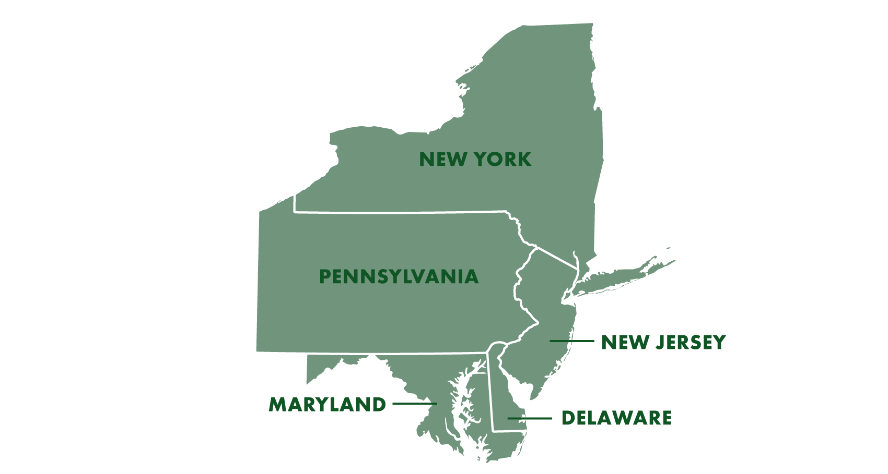
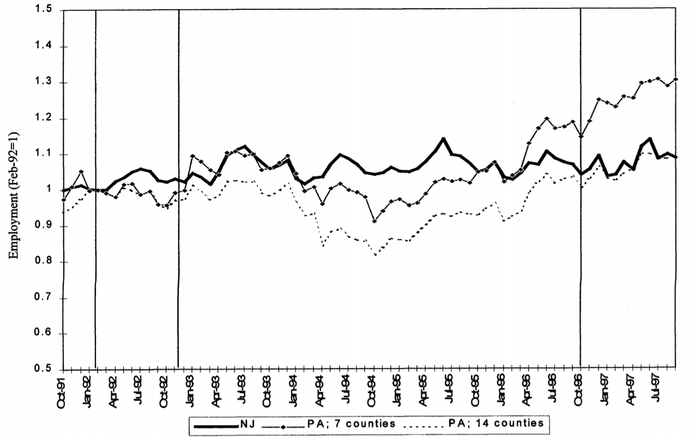

layout: true

<div class="my-footer"></div> 

---

```{r setup, include=FALSE,warning=FALSE,message=FALSE}
options(htmltools.dir.version = FALSE)
knitr::opts_chunk$set(
  message = FALSE,
  warning = FALSE,
  dev = "svg",
  cache = TRUE,
  fig.align = "center"
  #fig.width = 11,
  #fig.height = 5
)

library(emo)
library(tidyverse)
library(ggplot2)
library(kableExtra)
library(zoo)
library(scales)
library(grid)
library(pBrackets)
library(formattable)

  # fixer la graine aléatoire
set.seed(1234)
```

layout: true

<div class="my-footer"></div> 

---

# Rappel de la semaine dernière

* Application des outils d'inférence à l'analyse de régression

* *Erreur standard* des coefficients de régression

* *Significativité statistique* des coefficients de régression

--

## Aujourd'hui : ***Différences de différences***

* Exploite les changements de politique dans le temps qui ne touchent pas tout le monde

* Il faut trouver (ou construire) un ou plusieurs groupes de contrôle appropriés

* *Hypothèse clé :* tendances parallèles

* *Application empirique* : impact du ***salaire minimum*** sur l'***emploi***

---

# Méthodes d'évaluation

* La régression multiple ne fournit souvent pas d'estimations causales à cause de la ***sélection sur les non-observables***.

--

* Les RCT sont une façon de résoudre ce problème mais ils sont souvent impossibles à mettre en place.

--

* Quatre grandes méthodes d'évaluation causale utilisées en économie :

  - les ***variables instrumentales (IV)***,
  - l'***appariement sur le score de propension***,
  - les ***différences de différences (DiD)***, et
  - la ***régression sur discontinuité (RDD)***.

--

* Ces méthodes servent à identifier des __relations causales__ entre traitements et résultats.

--

* Dans ce cours, nous verrons une méthode d'évaluation de programmes populaire et rigoureuse : les __différences de différences__.

--

* La semaine prochaine, nous verrons la __régression sur discontinuité__.

---

# Différences de différences (DiD)

* Point de départ habituel : les sujets ne sont pas assignés aléatoirement au traitement `r emo::ji("warning")`

--

## Conditions pour un DiD :

--

* 2 périodes : avant et après le traitement.

--

* 2 groupes :

--
  - ***groupe de contrôle :*** ne reçoit jamais le traitement,

--

  - ***groupe de traitement :*** d'abord non traité, puis entièrement traité.
  
--

* Sous certaines hypothèses, le groupe de contrôle peut servir de contrefactuel au groupe de traitement  

---

# Un exemple : salaire minimum et emploi

--

* Imaginons que vous souhaitiez évaluer l'impact __causal__ d'une hausse du salaire minimum sur l'emploi (ou le chômage).

--

* Pourquoi n'est-ce pas si simple ? Quel devrait être le groupe de contrôle ?

--

* Article fondateur de 1994 ([lien](http://davidcard.berkeley.edu/papers/njmin-aer.pdf)) des célèbres économistes du travail David Card et Alan Krueger intitulé « Minimum Wages and Employment: A Case Study of the Fast-Food Industry in New Jersey and Pennsylvania »

--

* Il estime l'effet d'une hausse du salaire minimum sur le taux d'emploi dans la restauration rapide. Pourquoi ce secteur ?

---

# Détails institutionnels

* Aux États-Unis, il existe un salaire minimum national, mais les États peuvent s'en écarter.

--

* 1er avril 1992 : le salaire minimum du New Jersey passe de 4,25 USD à 5,05 USD de l'heure.

--

* La Pennsylvanie voisine n'a pas modifié son salaire minimum.

--

.pull-left[
```{r, echo = F, out.width = "600px"}

```
]

--

.pull-right[
<br>
<br>
La Pennsylvanie et le New Jersey sont ***très semblables*** : institutions similaires, habitudes similaires, consommateurs similaires, revenus similaires, climat similaire, etc.
]
---

# Card et Krueger (1994) : méthodologie

* Enquête auprès de 410 établissements de restauration rapide dans le New Jersey (NJ) et l'est de la Pennsylvanie

--

* Calendrier :

--
  - Enquête avant la hausse du salaire minimum du NJ : février/mars 1992

--
  - Enquête après la hausse du salaire minimum du NJ : novembre/décembre 1992

--

* Quelles comparaisons pensez-vous qu'ils ont faites ?

--

.pull-left[
Regardons de plus près leurs données
```{r, echo = FALSE, eval = TRUE, results = "hide"}
  # installer le package qui contient les données nettoyées
remotes::install_github("b-rodrigues/diffindiff")
  # charger le package
library(diffindiff)
  # charger les données
ck1994 <- njmin
```

```{r, echo = TRUE, eval = FALSE}
  # installer le package qui contient les données nettoyées
remotes::install_github("b-rodrigues/diffindiff")
  # charger le package
library(diffindiff)
  # charger les données
ck1994 <- njmin
```
]

--

.pull-right[
```{r}
ck1994 %>%
  select(sheet,chain,state,observation,empft,emppt) %>%
  head()
```

]
---

class: inverse

# Exercice 1 (10 minutes)

1. Jetez un œil au jeu de données et listez les variables. Consultez la définition des variables avec `?njmin`.

1. Tabulez le nombre d'établissements par `state` et par vague d'enquête (`observation`). Cela correspond-il au *Tableau 1* de l'[article](http://davidcard.berkeley.edu/papers/njmin-aer.pdf) ?

1. Créez une variable d'employés en équivalent temps plein (ETP, *FTE* en anglais) appelée `empfte`, égale à `empft` + 0.5*`emppt` + `nmgrs`. `empft` et `emppt` correspondent respectivement au nombre d'employés à temps plein et à temps partiel. `nmgrs` correspond au nombre de managers. C'est ainsi que Card et Krueger calculent leur variable d'emploi en équivalent temps plein (p. 775 de l'article).

1. Calculez l'emploi ETP moyen, le pourcentage moyen d'employés à temps plein (parmi les employés ETP) et le salaire de départ moyen (`wage_st`) par État et par vague d'enquête. Comparez vos résultats avec le *Tableau 2* de l'article.

5. Dans quelle mesure les restaurants de restauration rapide du New Jersey et de Pennsylvanie diffèrent-ils avant la hausse du salaire minimum ?

---

# DiD de Card et Krueger : résultats sous forme de tableau

.center[__Emploi moyen par établissement avant et après la hausse du salaire minimum du NJ__]
```{r, echo = FALSE, eval = TRUE}
# calculer l'emploi ETP moyen par État et par vague d'enquête
ck1994 <- ck1994 %>%
  mutate(empfte = empft + 0.5*emppt + nmgrs) %>%
  group_by(state,observation) %>%
  summarise(mean_fte = mean(empfte, na.rm = T))
# convertir au format data.frame
ck1994 <- as.data.frame(ck1994)

# recoder ck1994 pour une jolie présentation
ck_mw <- data.frame(
  Variable = c("Emploi ETP avant","Emploi ETP après","Variation de l'emploi
ETP moyen"),
  PA = c(
    ck1994[ck1994$state == "Pennsylvania" & ck1994$observation == "February 1992", "mean_fte"],
    ck1994[ck1994$state == "Pennsylvania" & ck1994$observation == "November 1992", "mean_fte"],
    ck1994[ck1994$state == "Pennsylvania" & ck1994$observation == "November 1992", "mean_fte"] -
      ck1994[ck1994$state == "Pennsylvania" & ck1994$observation == "February 1992", "mean_fte"]),
  NJ = c(
    ck1994[ck1994$state == "New Jersey" & ck1994$observation == "February 1992", "mean_fte"],
    ck1994[ck1994$state == "New Jersey" & ck1994$observation == "November 1992", "mean_fte"],
    ck1994[ck1994$state == "New Jersey" & ck1994$observation == "November 1992", "mean_fte"] -
      ck1994[ck1994$state == "New Jersey" & ck1994$observation == "February 1992", "mean_fte"]))

# présenter sous forme de tableau
ck_mw %>%
  mutate(
    PA = round(PA, 2),
    NJ = round(NJ, 2)
  ) %>%
  mutate(
    PA = ifelse(PA<0,
                cell_spec(PA, "html", background = viridis_pal()(2)[2], color = "white", bold = T, align = "c"),
                cell_spec(PA, "html", background = NULL, color = NULL, align = "c")),
    NJ = ifelse(NJ<1,
                cell_spec(NJ, "html", background = viridis_pal()(2)[1], color = "white", bold = T, align = "center"),
                cell_spec(NJ, "html", background = NULL, color = NULL, align = "c"))
  ) %>%
  kable(format = "html", digits = 2, escape = F,
        col.names = c("Variables", "Pennsylvanie", "New Jersey")) %>%
  kable_styling("striped", full_width = F)
```

--

## Estimation DiD

Estimation causale par différences de différences : $0.59 - (-2.17) = 2.76$

--

Interprétation : la hausse du salaire minimum a conduit à une __augmentation__ de l'emploi ETP par établissement de 2,76 en moyenne.

--

Oui, l'essence des différences de différences est _vraiment_ aussi simple ! `r emo::ji("grinning")`

--

Regardons ces résultats graphiquement.

---

# Le DiD graphiquement

```{r, echo = F, fig.width = 10, fig.height = 5}
ck_mw <- data.frame(
  date = as.Date(c("010292","010292","011192","011192"), format = "%d%m%y"),
  state = c("Pennsylvania","New Jersey","Pennsylvania","New Jersey"),
  fte_emp = c(23.33,20.44,21.17,21.03)
)

gg_did <- ggplot(ck_mw, aes(x = date, y = fte_emp, color = state)) +
    geom_vline(xintercept = as.Date("010492", format = "%d%m%y"), linetype = "longdash",
               color  = viridis_pal()(3)[2]) +
    geom_vline(xintercept = as.Date("010292", format = "%d%m%y"), linetype = "solid") +
    geom_vline(xintercept = as.Date("011192", format = "%d%m%y"), linetype = "solid") +
    ylim(17,24) +
    scale_x_date(labels = date_format("%h %y"),
                 limits = c(min(ck_mw$date),as.Date("011292", format = "%d%m%y")),
                 date_breaks = "1 month",
                 minor_breaks = NULL) +
    labs(x = NULL, y = "Nombre moyen d'employés ETP par établissement", color = NULL) +
    scale_colour_viridis_d() +
    theme_bw(base_size = 16) + 
    theme(legend.position="none") +
    annotate("label", x = as.Date("1992-05-28"), y = 23.99,
             label = "Hausse du salaire minimum dans le New Jersey", 
             color =  viridis_pal()(3)[2], size = 4.5) +
    annotate("label", x = as.Date("1992-02-26"), y = 23.99,
             label = "Enquête avant", color = "black", size = 4.5) +
    annotate("label", x = as.Date("1992-11-22"), y = 23.99,
             label = "Enquête après", color = "black", size = 4.5)
gg_did
```

---

# Le DiD graphiquement

```{r, echo = F, fig.width = 10, fig.height = 5}
gg_did_2 <- gg_did +
    geom_point(size = 3) +
    annotate("label", x = as.Date("1992-03-01"), y = 22.8, 
             label = "Pennsylvanie - fév. 92", color = viridis_pal()(2)[2], size = 4) +
    annotate("label", x = as.Date("1992-03-01"), y = 20, 
             label = "New Jersey - fév. 92", color = viridis_pal()(2)[1], size = 4) +
    annotate("label", x = as.Date("1992-10-01"), y = 21.75, 
             label = "Pennsylvanie - nov. 92", color = viridis_pal()(2)[2], size = 4) +
    annotate("label", x = as.Date("1992-10-01"), y = 20.5, 
             label = "New Jersey - nov. 92", color = viridis_pal()(2)[1], size = 4)
gg_did_2
```

---

# Le DiD graphiquement

```{r, echo = F, fig.width = 10, fig.height = 5}
gg_did_3 <- gg_did +
    geom_point(size = 3) +
    annotate("label", x = as.Date("1992-05-15"), y = 23, 
             label = "Pennsylvanie", color = viridis_pal()(2)[2], size = 4) +
    geom_line(data = ck_mw[ck_mw$state == "Pennsylvania",],
              aes(x = date, y = fte_emp), linetype = "solid")
gg_did_3
```

---

# Le DiD graphiquement

```{r, echo = F, fig.width = 10, fig.height = 5}
new_jersey_counterfactual <- data.frame(
    date = as.Date(c("010292","011192"), format = "%d%m%y"),
    state = c("New Jersey","New Jersey"),
    fte_emp = c(20.44, 18.28)
)

gg_did_4 = gg_did_3 +
    geom_line(data = new_jersey_counterfactual, aes(x = date, y = fte_emp), 
              linetype = "longdash") +
    annotate("label", x = as.Date("1992-07-15"), y = 18.5, 
             label = "Contrefactuel du New Jersey", color = viridis_pal()(2)[1], size = 4.5)
gg_did_4

```

---

# Le DiD graphiquement

```{r, echo = F, fig.width = 10, fig.height = 5}
# trajectoire réelle 
new_jersey_real <- data.frame(
    date = as.Date(c("010292","010492","011192"), format = "%d%m%y"),
    state = c("New Jersey","New Jersey","New Jersey"),
    fte_emp = c(20.44, 19.95,21.03)
)

gg_did_5 = gg_did_3 +
    geom_line(data = new_jersey_counterfactual, aes(x = date, y = fte_emp), 
              linetype = "longdash") +
    geom_line(data = new_jersey_real, aes(x = date, y = fte_emp), linetype = "solid") +
    annotate("label", x = as.Date("1992-05-15"), y = 20.75, 
             label = "New Jersey", color = viridis_pal()(2)[1], size = 4)
gg_did_5
```

---

# Le DiD graphiquement

```{r, echo = F, fig.width = 10, fig.height = 5}
gg_did_5 +
  annotate("text", x = as.Date("1992-11-26"), y = 19.7, label = "Effet du\ntraitement", color = "black", size = 5)
x = 623
ymin = 150
ymax = ymin+114
grid.brackets(x,
              ymin,
              x,
              ymax,
              h = 0.05, lwd=1, col="black")
```

---

# Et si nous avions fait une comparaison naïve après/avant ?

```{r, echo = F, fig.width = 10, fig.height = 5}
gg_did_3 +
  annotate("text", x = as.Date("1992-11-26"), y = 20.9, label = "Effet\nnaïf du\ntraitement",
           color = "black", size = 5) +
  geom_segment(aes(x = as.Date("010292", format = "%d%m%y"), y = ck_mw[2,"fte_emp"], 
                   xend = as.Date("011192", format = "%d%m%y"), yend = ck_mw[2,"fte_emp"]),
               color = viridis_pal()(2)[1], linetype = "dashed") +
  annotate("label", x = as.Date("1992-06-08"), y = 20.1, 
           label = "Contrefactuel naïf du New Jersey", 
           color = viridis_pal()(2)[1], size = 5)
x = 623
ymin = 150
ymax = ymin+24
grid.brackets(x,
              ymin,
              x,
              ymax,
              h = 0.05, lwd=1, col="black")

```

---

# Et si nous avions fait une comparaison naïve après/avant ?

```{r, echo = F, fig.width = 10, fig.height = 5}
gg_did_3 +
  geom_line(data = new_jersey_real, aes(x = date, y = fte_emp), linetype = "solid") +
  geom_line(data = new_jersey_counterfactual, aes(x = date, y = fte_emp), 
            linetype = "longdash") +
  geom_segment(aes(x = as.Date("010292", format = "%d%m%y"), y = ck_mw[2,"fte_emp"], 
                   xend = as.Date("011192", format = "%d%m%y"), yend = ck_mw[2,"fte_emp"]),
               color = viridis_pal()(2)[1], linetype = "dashed") +
  annotate("text", x = as.Date("1992-11-26"), y = 21.1, label = "Effet\nnaïf du\ntraitement",
           color = "black", size = 5) +
  annotate("text", x = as.Date("1992-11-26"), y = 19.45, label = "Effet\nréel du\ntraitement",
           color = "black", size = 5) +
  annotate("label", x = as.Date("1992-09-01"), y = 21.1, 
           label = "New Jersey", 
           color = viridis_pal()(2)[1], size = 5) +
  annotate("label", x = as.Date("1992-05-01"), y = 20.75, 
           label = "Contrefactuel naïf du New Jersey", 
           color = viridis_pal()(2)[1], size = 4) +
  annotate("label", x = as.Date("1992-06-08"), y = 18.75, 
           label = "Contrefactuel du New Jersey", 
           color = viridis_pal()(2)[1], size = 5)
x = 635
ymin = 150
ymax = ymin+24
grid.brackets(x,
              ymin,
              x,
              ymax,
              h = 0.05, lwd=1, col="black")
x = 623
ymin = 150
ymax = ymin+114
grid.brackets(x,
              ymin,
              x,
              ymax,
              h = 0.05, lwd=1, col="black")

```

---

# Et si nous avions fait une comparaison naïve NJ/PA après la hausse ?

```{r, echo = F, fig.width = 10, fig.height = 5}
gg_did_3 +
  geom_segment(aes(x = as.Date("010292", format = "%d%m%y"), y = ck_mw[3,"fte_emp"], 
                   xend = as.Date("011192", format = "%d%m%y"), yend = ck_mw[3,"fte_emp"]),
               color = viridis_pal()(2)[1], linetype = "dashed") +
  annotate("label", x = as.Date("1992-06-08"), y = 21.5, 
           label = "Contrefactuel naïf du New Jersey", 
           color = viridis_pal()(2)[1], size = 5) +
  annotate("text", x = as.Date("1992-11-26"), y = 20.9, label = "Effet\nnaïf du\ntraitement", color = "black", size = 5)
x = 623
ymin = 142
ymax = ymin+6
grid.brackets(x,
              ymin,
              x,
              ymax,
              h = 0.05, lwd=1, col="black")

```

---

# Et si nous avions fait une comparaison naïve NJ/PA après la hausse ?

```{r, echo = F, fig.width = 10, fig.height = 5}
gg_did_3 +
  geom_segment(aes(x = as.Date("010292", format = "%d%m%y"), y = ck_mw[3,"fte_emp"], 
                   xend = as.Date("011192", format = "%d%m%y"), yend = ck_mw[3,"fte_emp"]),
               color = viridis_pal()(2)[1], linetype = "dashed") +
  annotate("label", x = as.Date("1992-06-08"), y = 21.5, 
           label = "Contrefactuel naïf du New Jersey", 
           color = viridis_pal()(2)[1], size = 4) +
  geom_line(data = new_jersey_real, aes(x = date, y = fte_emp), linetype = "solid") +
  annotate("text", x = as.Date("1992-11-26"), y = 21.1, label = "Effet\nnaïf du\ntraitement", color = "black", size = 5) +
  annotate("text", x = as.Date("1992-11-26"), y = 19.45, label = "Effet\nréel du\ntraitement", color = "black", size = 5) +
  geom_line(data = new_jersey_counterfactual, aes(x = date, y = fte_emp), 
            linetype = "longdash") +
    annotate("label", x = as.Date("1992-09-01"), y = 20.3, 
           label = "New Jersey", 
           color = viridis_pal()(2)[1], size = 5) +
  annotate("label", x = as.Date("1992-06-08"), y = 18.75, 
           label = "Contrefactuel du New Jersey", 
           color = viridis_pal()(2)[1], size = 5)

x = 623
ymin = 142
ymax = ymin+6
grid.brackets(x,
              ymin,
              x,
              ymax,
              h = 0.05, lwd=1, col="black")
x = 623
ymin = 150
ymax = ymin+114
grid.brackets(x,
              ymin,
              x,
              ymax,
              h = 0.05, lwd=1, col="black")

```

---

layout: false
class: title-slide-section-red, middle

# Estimation

---

layout: true

<div class="my-footer"></div> 

---

# Le DiD sous forme de régression

* En pratique, le DiD est généralement estimé sur plus de 2 périodes (4 observations)

* Il y a davantage de points de données avant et après le changement de politique

--

3 ingrédients :

--

1. __Variable dummy de traitement__ : $TREAT_s$ où l'indice $s$ nous rappelle que le traitement se situe au niveau de l'État

--

1. __Variable dummy des périodes post-traitement__ : $POST_t$ où l'indice $t$ nous rappelle que cette variable varie dans le temps

--

1. __Terme d'interaction entre les deux__ : $TREAT_s \times POST_t$ `r emo::ji("point_right")` le ***coefficient de ce terme est l'effet causal DiD*** !

---

# Le DiD sous forme de régression

__Variable dummy de traitement__
$$
TREAT_s = \begin{cases}\begin{array}{lcl}
0 \quad \text{si } s = \text{Pennsylvanie} \\\
1 \quad \text{si } s = \text{New Jersey}
\end{array}\end{cases}
$$

--

__Variable dummy des périodes post-traitement__
$$
POST_t = \begin{cases}\begin{array}{lcl}
0 \quad \text{si } t < \text{1er avril 1992} \\\
1 \quad \text{si } t \geq \text{1er avril 1992}
\end{array}\end{cases}
$$

--

__Quelles observations correspondent à $TREAT_s \times POST_t = 1$ ?__

--

* Rassemblons tous ces ingrédients :
$$EMP_{st} = \alpha + \beta TREAT_s + \gamma POST_t + \delta(TREAT_s \times POST_t) + \varepsilon_{st}$$

* $\delta$ : effet causal de la hausse du salaire minimum sur l'emploi

---

# Comprendre la régression

$$EMP_{st} = \color{#d96502}\alpha + \color{#027D83}\beta TREAT_s + \color{#02AB0D}\gamma POST_t + \color{#d90502}\delta(TREAT_s \times POST_t) + \varepsilon_{st}$$

--

Nous avons :

--

$\mathbb{E}(EMP_{st} \; | \; TREAT_s = 0, POST_t = 0) = \color{#d96502}\alpha$

--

$\mathbb{E}(EMP_{st} \; | \; TREAT_s = 0, POST_t = 1) = \color{#d96502}\alpha + \color{#02AB0D}\gamma$

--

$\mathbb{E}(EMP_{st} \; | \; TREAT_s = 1, POST_t = 0) = \color{#d96502}\alpha + \color{#027D83}\beta$

--

$\mathbb{E}(EMP_{st} \; | \; TREAT_s = 1, POST_t = 1) = \color{#d96502}\alpha + \color{#027D83}\beta + \color{#02AB0D}\gamma + \color{#d90502}\delta$

--

$$[\mathbb{E}(EMP_{st} \; | \; TREAT_s = 1, POST_t = 1)-\mathbb{E}(EMP_{st} \; | \; TREAT_s = 1, POST_t = 0)] - \\
[\mathbb{E}(EMP_{st} \; | \; TREAT_s = 0, POST_t = 1)-\mathbb{E}(EMP_{st} \; | \; TREAT_s = 0, POST_t = 0)] = \color{#d90502}\delta$$

---

# Comprendre la régression

$$EMP_{st} = \color{#d96502}\alpha + \color{#027D83}\beta TREAT_s + \color{#02AB0D}\gamma POST_t + \color{#d90502}\delta(TREAT_s \times POST_t) + \varepsilon_{st}$$

Sous forme de tableau :


   | Moyenne avant | Moyenne après | $\Delta$(après - avant)
:-:|:--:|:--:|:--:
Pennsylvanie (PA) | $\color{#d96502}\alpha$ | $\color{#d96502}\alpha + \color{#02AB0D}\gamma$ | $\color{#02AB0D}\gamma$
New Jersey (NJ) | $\color{#d96502}\alpha + \color{#027D83}\beta$ | $\color{#d96502}\alpha + \color{#027D83}\beta + \color{#02AB0D}\gamma + \color{#d90502}\delta$ | $\color{#02AB0D}\gamma + \color{#d90502}\delta$
$\Delta$(NJ - PA) | $\color{#027D83}\beta$ | $\color{#027D83}\beta + \color{#d90502}\delta$ | $\color{#d90502}\delta$

--

Ce tableau se généralise à d'autres contextes en remplaçant *Pennsylvanie* par *Contrôle* et *New Jersey* par *Traitement*
---

class: inverse

# Exercice 2 (10 minutes)

1. Créez une variable dummy, `treat`, égale à `FALSE` si `state` est la Pennsylvanie et `TRUE` si c'est le New Jersey.

1. Créez une variable dummy, `post`, égale à `FALSE` si `observation` est février 1992 et `TRUE` sinon.

1. Estimez le modèle de régression suivant. Obtenez-vous les mêmes résultats qu'à la slide 9 ?

$$empfte_{st} = \alpha + \beta treat_s + \gamma post_t + \delta(treat_s \times post_t) + \varepsilon_{st}$$

---

layout: false
class: title-slide-section-red, middle

# Hypothèses d'identification

---

layout: true

<div class="my-footer"></div> 

---

# L'hypothèse cruciale du DiD : les tendances parallèles

> __Hypothèse de tendances communes ou parallèles__ : en l'absence de hausse du salaire minimum, la tendance de l'emploi dans la restauration rapide en Pennsylvanie aurait été celle que l'on aurait dû observer dans le New Jersey.

--

* Cette hypothèse stipule que la tendance de l'emploi dans la restauration rapide en Pennsylvanie entre février et novembre 1992 fournit un contrefactuel fiable de la tendance de l'emploi que la restauration rapide du New Jersey *aurait connue* si le New Jersey n'avait pas augmenté son salaire minimum.

--

* Il est impossible de valider ou d'invalider complètement cette hypothèse.

* *Vérification intuitive :* comparer les tendances avant le changement de politique (et après le changement si l'on n'attend pas d'effets à moyen terme)

---

#  Tendances parallèles : graphiquement

```{r, echo = FALSE, eval = TRUE, fig.width = 10, fig.height = 5}
gg_did_5
```

---

# Vérifier l'hypothèse de tendances parallèles


```{r, echo = F, fig.width = 10, fig.height = 5}
gg_did_trend <- ggplot(ck_mw, aes(x = date, y = fte_emp, color = state)) +
    geom_vline(xintercept = as.Date("010492", format = "%d%m%y"), linetype = "longdash",
               color  = viridis_pal()(3)[2]) +
    geom_vline(xintercept = as.Date("010292", format = "%d%m%y"), linetype = "solid") +
    geom_vline(xintercept = as.Date("011192", format = "%d%m%y"), linetype = "solid") +
    ylim(17,24) +
  scale_x_date(labels = date_format("%h %y"),
               limits = c(as.Date("011091", format = "%d%m%y"),as.Date("011292", format = "%d%m%y")),
               date_breaks = "1 month",
               minor_breaks = NULL) +
  labs(x = NULL, y = "Nombre moyen d'employés ETP par établissement", color = NULL) +
  scale_colour_viridis_d() +
  theme_bw(base_size = 16) + theme(legend.position="none") +
    annotate("label", x = as.Date("1992-05-28"), y = 23.99,
             label = "Hausse du salaire minimum dans le New Jersey",
             color =  viridis_pal()(3)[2], size = 4.5) +
  annotate("label", x = as.Date("1991-12-28"), y = 23.99, label = "Enquête avant", color = "black", size = 4.5) +
  annotate("label", x = as.Date("1992-11-23"), y = 23.99, label = "Enquête après", color = "black", size = 4.5)

gg_did_trend +
      geom_point(size = 3) +
    annotate("label", x = as.Date("1992-03-01"), y = 22.8, 
             label = "Pennsylvanie - fév. 92", color = viridis_pal()(2)[2], size = 4) +
    annotate("label", x = as.Date("1992-03-01"), y = 20, 
             label = "New Jersey - fév. 92", color = viridis_pal()(2)[1], size = 4) +
    annotate("label", x = as.Date("1992-10-01"), y = 21.75, 
             label = "Pennsylvanie - nov. 92", color = viridis_pal()(2)[2], size = 4) +
    annotate("label", x = as.Date("1992-10-01"), y = 20.5, 
             label = "New Jersey - nov. 92", color = viridis_pal()(2)[1], size = 4) +
  annotate("label", x = as.Date("1992-01-15"), y = 21.5, label = "Que se passait-il\navant avril 92 ?", color = "black", size = 6)
```

---

# Vérifier l'hypothèse de tendances parallèles

```{r, echo = F, fig.width = 10, fig.height = 5}
new_jersey_counterfactual <- data.frame(
    date = as.Date(c("151191","010292","011192"), format = "%d%m%y"),
    state = c("New Jersey","New Jersey","New Jersey"),
    fte_emp = c(21.05489,20.44,18.28)
)

new_jersey_counterfactual_1 <- data.frame(
    date = as.Date(c("151191","010292","010492","011192"), format = "%d%m%y"),
    state = c("New Jersey","New Jersey","New Jersey","New Jersey"),
    fte_emp = c(20.44,20.44,20.44,20.44)
)

new_jersey_counterfactual_2 <- data.frame(
    date = as.Date(c("151191","010292","010492","011192"), format = "%d%m%y"),
    state = c("New Jersey","New Jersey","New Jersey","New Jersey"),
    fte_emp = c(20,20.44,20.77846,21.98564)
)

pennsylvania_before =  data.frame(
    date = as.Date(c("151191","010292"), format = "%d%m%y"),
    state = c("Pennsylvania","Pennsylvania"),
    fte_emp = c(23.94489,23.33))

gg_did_trend +
      annotate("label", x = as.Date("1992-05-15"), y = 23, 
             label = "Pennsylvanie", color = viridis_pal()(2)[2], size = 4) +
    geom_line(data = ck_mw[ck_mw$state == "Pennsylvania",],
              aes(x = date, y = fte_emp), linetype = "solid") +
  geom_point(size = 3) +
  geom_line(data = pennsylvania_before, aes(x = date, y = fte_emp), 
            linetype = "longdash",color = viridis_pal()(2)[2]) +
  geom_line(data = new_jersey_counterfactual, aes(x = date, y = fte_emp), 
            linetype = "longdash") +
  geom_line(data = new_jersey_counterfactual_1, aes(x = date, y = fte_emp), 
            linetype = "longdash") +
  geom_line(data = new_jersey_counterfactual_2, aes(x = date, y = fte_emp), 
            linetype = "longdash") +
  annotate("label", x = as.Date("1992-05-15"), y = 19, label = "Contrefactuels possibles du New Jersey", color = viridis_pal()(2)[1], size = 4)

```

---

# Hypothèse de tendances parallèles $\rightarrow$ Vérifiée `r emo::ji("white_check_mark")`

```{r, echo = F, fig.width = 10, fig.height = 5}
gg_did_trend_val = gg_did_trend +
  geom_line(data = pennsylvania_before, aes(x = date, y = fte_emp), 
            linetype = "longdash",color = viridis_pal()(2)[2]) +
  annotate("label", x = as.Date("1992-05-15"), y = 23, 
             label = "Pennsylvanie", color = viridis_pal()(2)[2], size = 4) +
  geom_line(data = ck_mw[ck_mw$state == "Pennsylvania",],
              aes(x = date, y = fte_emp), linetype = "solid") +
  geom_point(size = 3) +
  geom_line(data = new_jersey_counterfactual, aes(x = date, y = fte_emp), 
            linetype = "longdash") +
  geom_line(data = new_jersey_real, aes(x = date, y = fte_emp), 
            linetype = "solid")  +
  annotate("label", x = as.Date("1992-05-15"), y = 19, label = "Contrefactuel du New Jersey", color = viridis_pal()(2)[1], size = 4) +
    annotate("label", x = as.Date("1992-05-15"), y = 20.75, label = "New Jersey", color = viridis_pal()(2)[1], size = 4) +
    annotate("rect", xmin=as.Date("011091", format = "%d%m%y"), xmax=as.Date("010492", format = "%d%m%y"), ymin=20 , ymax=23.5, alpha=0.4, color="#21908CFF", fill="#21908CFF") +
  annotate("text", x=as.Date("011291", format = "%d%m%y"), y=22, label = "Les tendances d\'emploi\nsont similaires", color = "black", size = 5)
gg_did_trend_val

```

---

# Hypothèse de tendances parallèles $\rightarrow$ Vérifiée `r emo::ji("white_check_mark")`

```{r, echo = F, fig.width = 10, fig.height = 5}
gg_did_trend_val +
  geom_line(data = new_jersey_counterfactual, aes(x = date, y = fte_emp), 
              linetype = "dashed", color = viridis_pal()(2)[2]) +
  annotate("label", x = as.Date("1992-07-15"), y = 18.5, 
             label = "Contrefactuel DiD du New Jersey", color = viridis_pal()(2)[2], size = 4.5) +
   annotate("text", x = as.Date("1992-11-28"), y = 19.6, 
           label = "Effet\nréel du\ntraitement\n=\nEffet\nDiD du\ntraitement", color = "black", size = 4)

x = 640
ymin = 150
ymax = ymin+114
grid.brackets(x,
              ymin,
              x,
              ymax,
              h = 0.05, lwd=1, col="black")
```

---

# Hypothèse de tendances parallèles $\rightarrow$ Non vérifiée `r emo::ji("x")`

```{r, echo = F, fig.width = 10, fig.height = 5}

new_jersey_real_2 <- data.frame(
    date = as.Date(c("010292","010492","011192"), format = "%d%m%y"),
    state = c("New Jersey","New Jersey","New Jersey"),
    fte_emp = c(20.44,20.77846,21.03)
)

gg_did_trend_not_val = gg_did_trend +
  geom_line(data = pennsylvania_before, aes(x = date, y = fte_emp), 
            linetype = "longdash",color = viridis_pal()(2)[2]) +
  annotate("label", x = as.Date("1992-05-15"), y = 23, 
             label = "Pennsylvanie", color = viridis_pal()(2)[2], size = 4) +
  geom_line(data = ck_mw[ck_mw$state == "Pennsylvania",],
              aes(x = date, y = fte_emp), linetype = "solid") +
  geom_point(size = 3) +
  geom_line(data = new_jersey_counterfactual_2, aes(x = date, y = fte_emp), 
            linetype = "longdash") +
  geom_line(data = new_jersey_real_2, aes(x = date, y = fte_emp), 
            linetype = "solid")  +
  annotate("label", x = as.Date("1992-05-01"), y = 21.6, label = "Contrefactuel du New Jersey", color = viridis_pal()(2)[1], size = 4) +
    annotate("label", x = as.Date("1992-05-15"), y = 20.4, label = "New Jersey", color = viridis_pal()(2)[1], size = 4) +
    annotate("rect", xmin=as.Date("011091", format = "%d%m%y"), xmax=as.Date("010492", format = "%d%m%y"), ymin=20 , ymax=23.5, alpha=0.4, color="#21908CFF", fill="#21908CFF") +
  annotate("text", x=as.Date("011291", format = "%d%m%y"), y=22, label = "Les tendances d\'emploi\nne sont pas similaires", color = "black", size = 5)
gg_did_trend_not_val
```

---

# Hypothèse de tendances parallèles $\rightarrow$ Non vérifiée `r emo::ji("x")`

```{r, echo = F, fig.width = 10, fig.height = 5}
gg_did_trend_not_val + 
  geom_line(data = pennsylvania_before, aes(x = date, y = fte_emp), 
            linetype = "longdash",color = viridis_pal()(2)[2]) +
  geom_line(data = new_jersey_counterfactual, aes(x = date, y = fte_emp), 
              linetype = "longdash", color = viridis_pal()(2)[2]) +
  annotate("label", x = as.Date("1992-07-15"), y = 18.5, 
             label = "Contrefactuel DiD du New Jersey", 
             color = viridis_pal()(2)[2], size = 4.5) +
  annotate("text", x = as.Date("1992-11-28"), y = 19.45, 
           label = "Effet\nDiD du\ntraitement", color = "black", size = 4) +
  annotate("text", x = as.Date("1992-11-28"), y = 21.4, 
           label = "Effet\nréel du\ntraitement", color = "black", size = 4)

x = 640
ymin = 108
ymax = ymin+42
grid.brackets(x,
              ymin,
              x,
              ymax,
              h = 0.05, lwd=1, col="black")
x = 640
ymin = 150
ymax = ymin+114
grid.brackets(x,
              ymin,
              x,
              ymax,
              h = 0.05, lwd=1, col="black")
```

---

# Hypothèse de tendances parallèles : [Card et Krueger (2000)](https://inequality.stanford.edu/sites/default/files/media/_media/pdf/Reference%20Media/Card%20and%20Krueger_2000_Policy.pdf)

Voici les tendances réelles pour la Pennsylvanie et le New Jersey

```{r, echo = F, out.width = "600px"}

```

--

* L'hypothèse de tendance commune est-elle probablement vérifiée ? 
---

# L'hypothèse de tendances parallèles : formellement

Soit :

* $Y_{ist}^1$ : l'emploi dans la restauration rapide du restaurant $i$ de l'État $s$ à la date $t$ si le salaire minimum de l'État est élevé ;

--

* $Y_{ist}^0$ : l'emploi dans la restauration rapide du restaurant $i$ de l'État $s$ à la date $t$ si le salaire minimum de l'État est bas ;

--

Ce sont des résultats potentiels, on ne peut observer qu'un seul des deux.

--

L'hypothèse clé du DiD est que, en l'absence de traitement, le résultat du restaurant $i$ dans l'État $s$ à la date $t$ est donné par :

$$\mathbb{E}[Y_{ist}^0|s,t] = \gamma_s + \lambda_t$$

2 hypothèses implicites :

1. ***Biais de sélection*** : lié aux caractéristiques fixes de l'État $(\gamma)$

2. ***Tendance temporelle*** : même tendance temporelle pour le groupe de traitement et le groupe de contrôle $(\lambda)$

---

# L'hypothèse de tendances parallèles : formellement

Résultats dans le groupe de comparaison :

$$\mathbb{E}[Y_{ist}| s = \text{Pennsylvanie},t = \text{Feb}] = \gamma_{PA} + \lambda_{Feb}$$
--

$$\mathbb{E}[Y_{ist}|s = \text{Pennsylvanie},t = \text{Nov}] = \gamma_{PA} + \lambda_{Nov}$$

--

$$
\begin{align}
\mathbb{E}[Y_{ist}&|s = \text{Pennsylvanie},t = \text{Nov}] - \mathbb{E}[Y_{ist}| s = \text{Pennsylvanie},t = \text{Feb}] \\
&= \gamma_{PA} + \lambda_{Nov} - (\gamma_{PA} + \lambda_{Feb}) \\
&= \lambda_{Nov} - \lambda_{Feb}
\end{align}
$$

---

# L'hypothèse de tendances parallèles : formellement

Résultats dans le groupe de comparaison :

$$\mathbb{E}[Y_{ist}| s = \text{Pennsylvanie},t = \text{Feb}] = \gamma_{PA} + \lambda_{Feb}$$

$$\mathbb{E}[Y_{ist}|s = \text{Pennsylvanie},t = \text{Nov}] = \gamma_{PA} + \lambda_{Nov}$$

$$
\begin{align}
\mathbb{E}[Y_{ist}&|s = \text{Pennsylvanie},t = \text{Nov}] - \mathbb{E}[Y_{ist}| s = \text{Pennsylvanie},t = \text{Feb}] \\
&= \gamma_{PA} + \lambda_{Nov} - (\gamma_{PA} + \lambda_{Feb}) \\
&= \underbrace{\lambda_{Nov} - \lambda_{Feb}}_{\text{tendance temporelle}}
\end{align}
$$

--

$\rightarrow$ le groupe de comparaison permet d'estimer la ***tendance temporelle***.

---

# L'hypothèse de tendances parallèles : formellement

Soit $\delta$ le véritable impact de la hausse du salaire minimum :

$$\mathbb{E}[Y_{ist}^1 - Y_{ist}^0|s,t] = \delta$$

--

Résultats dans le groupe de traitement :

$$\mathbb{E}[Y_{ist}|s = \text{New Jersey}, t = \text{Feb}] = \gamma_{NJ} + \lambda_{Feb}$$
--

$$\mathbb{E}[Y_{ist}|s = \text{New Jersey}, t = \text{Nov}] = \gamma_{NJ} + \delta + \lambda_{Nov}$$
--

$$
\begin{align}
\mathbb{E}[Y_{ist}&|s = \text{New Jersey}, t = \text{Nov}] - \mathbb{E}[Y_{ist}|s = \text{New Jersey}, t = \text{Feb}] \\
&= \gamma_{NJ} + \delta + \lambda_{Nov} - (\gamma_{NJ} + \lambda_{Feb}) \\
&= \delta + \lambda_{Nov} - \lambda_{Feb}
\end{align}
$$

---

# L'hypothèse de tendances parallèles : formellement

Soit $\delta$ le véritable impact de la hausse du salaire minimum :

$$\mathbb{E}[Y_{ist}^1 - Y_{ist}^0|s,t] = \delta$$

Résultats dans le groupe de traitement :

$$\mathbb{E}[Y_{ist}|s = \text{New Jersey}, t = \text{Feb}] = \gamma_{NJ} + \lambda_{Feb}$$

$$\mathbb{E}[Y_{ist}|s = \text{New Jersey}, t = \text{Nov}] = \gamma_{NJ} + \delta + \lambda_{Nov}$$

$$
\begin{align}
\mathbb{E}[Y_{ist}&|s = \text{New Jersey}, t = \text{Nov}] - \mathbb{E}[Y_{ist}|s = \text{New Jersey}, t = \text{Feb}] \\
&= \gamma_{NJ} + \delta + \lambda_{Nov} - (\gamma_{NJ} + \lambda_{Feb}) \\
&= \delta + \underbrace{\lambda_{Nov} - \lambda_{Feb}}_{\text{tendance temporelle}}
\end{align}
$$

---

# L'hypothèse de tendances parallèles : formellement

Nous avons donc :

$$
\begin{align}
\mathbb{E}[Y_{ist}&|s = \text{PA},t = \text{Nov}] - \mathbb{E}[Y_{ist}| s = \text{PA},t = \text{Feb}] = \underbrace{\lambda_{Nov} - \lambda_{Feb}}_{\text{tendance temporelle}}
\end{align}
$$

--

$$
\begin{align}
\mathbb{E}[Y_{ist}&|s = \text{NJ},t = \text{Nov}] - \mathbb{E}[Y_{ist}| s = \text{NJ},t = \text{Feb}] = \delta + \underbrace{\lambda_{Nov} - \lambda_{Feb}}_{\text{tendance temporelle}}
\end{align}
$$

--

$$
\begin{align}
DD &= \mathbb{E}[Y_{ist}|s = \text{NJ}, t = \text{Nov}] - \mathbb{E}[Y_{ist}|s = \text{NJ}, t = \text{Feb}] \\
& \qquad \qquad - \Big(\mathbb{E}[Y_{ist}|s = \text{PA},t = \text{Nov}] - \mathbb{E}[Y_{ist}| s = \text{PA},t = \text{Feb}]\Big) \\
&= \delta + \lambda_{Nov} - \lambda_{Feb} - (\lambda_{Nov} - \lambda_{Feb}) \\
&= \delta
\end{align}
$$

---
class: title-slide-final, middle
background-image: url(../img/logo/namur-logo.png)
background-size: 250px
background-position: 9% 19%

# BONNE JOURNÉE !


|                                                                                                            |                                   |
| :--------------------------------------------------------------------------------------------------------- | :-------------------------------- |
| <a href="mailto:jeremy.donascimento@unamur.be">.Namurgreen[<i class="fa fa-paper-plane fa-fw"></i>]               | jeremy.donascimento@unamur.be       |
| <a href="https://discord.gg/RcdCRFBcc">.Namurgreen[<i class="fab fa-link fa-fw"></i></a>] | Discord |
| <a href="https://github.com/jdnmiguel/econometric_ECGEB352">.Namurgreen[<i class="fa fa-link fa-fw"></i>] | Slides |

