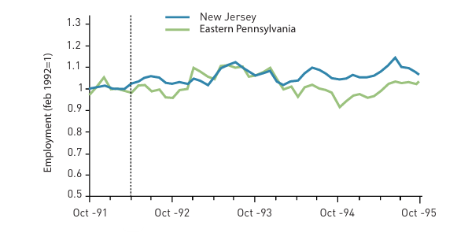
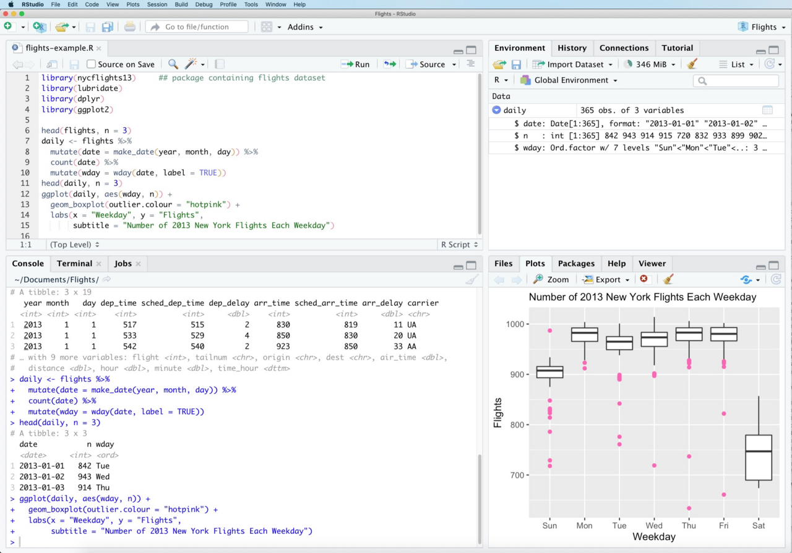
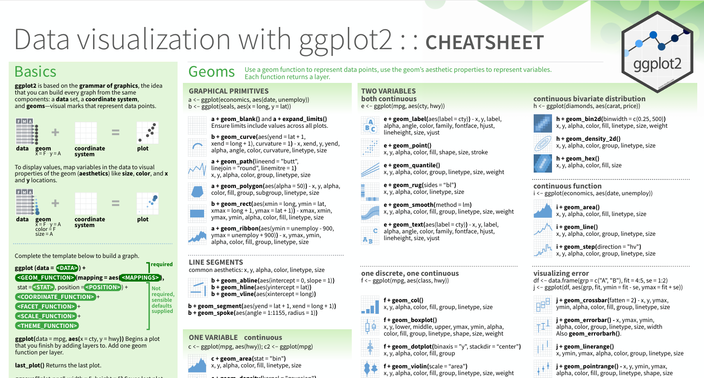

layout: true

<div class="my-footer"></div> 

---

```{r setup, include = FALSE, warning = FALSE, message = FALSE}
options(htmltools.dir.version = FALSE)
knitr::opts_chunk$set(
  message = FALSE,
  warning = FALSE,
  dev = "svg",
  cache = TRUE,
  fig.align = "center"
  #fig.width = 11,
  #fig.height = 5
)

# Load packages
library(tidyverse)
library(pander)
library(ggthemes)
library(gapminder)
library(countdown)
library(xaringanExtra)

# countdown style
countdown(
  color_border              = "forestgreen",
  color_text                = "black",
  color_running_background  = "forestgreen",
  color_running_text        = "white",
  color_finished_background = "white",
  color_finished_text       = "forestgreen",
  color_finished_border     = "forestgreen"
)
```

# Bienvenue au cours d'Econométire !

--

- Dans ce cours, vous allez apprendre les éléments essentiels de l'***économetrie***.
 
--

- Vous allez aussi apprendre comment utiliser le langage de programmation `R` !

--

## Qu'est ce que l'*économétrie*?

- Un ensemble de **méthodes et techniques statistiques** utilisé pour mesurer des relations économiques, tester la théorie économique, ou évaluer des politiques publiques à l'aide de **données**.

- Quelques exemples !

---

# Répondre à des Questions Economiques avec l'Econométrie

[<ru-blockquote>
Est-ce que l'immigration  **entraine** des plus faibles revenus et/ou un plus fort chômage pour les populations locales?
</ru-blockquote>](http://davidcard.berkeley.edu/papers/mariel-impact.pdf)

--

[<ru-blockquote>
Est-ce que donner des vermifuges aux enfants **réduit** l'abstéisme à l'école ?
</ru-blockquote>](https://emiguel.econ.berkeley.edu/wordpress/wp-content/uploads/2021/03/Paper__Worms.pdf)

--

[<ru-blockquote>
Est-ce que investir dans les librairies publiques  **améliore** les résultats scolaires ? 
</ru-blockquote>](https://www.aeaweb.org/research/charts/public-library-returns-investment)

--


[<ru-blockquote>
Est-ce que le quartier de naissance a un  **effet** sur la réussite professionnelle ?
</ru-blockquote>](https://academic.oup.com/qje/article/133/3/1107/4850660)

---

# Causalité

* Attention, ***une multitude d'autres éléments peuvent causer*** chacun des outcomes mentionnés.

--

* Souvent, on souhaite se concentré sur ***l'effet causal*** d'un seul de ces éléments (immigration, vermifuge, education ,etc.)

--

* L'économétrie se concentre sur l'établissement des ***conditions*** grâce auxquelles nous pouvons  ***dire que la relation mesurée est causale***.

* Nous allons parler brièvement de ces conditions, ce n'est pas le coeur de ce cours.

* ["Credibility Revolution"](https://www.aeaweb.org/articles?id=10.1257/jep.24.2.3) en économétrie au cours des 30 dernières années, avec en point d'orgue  ([Prix Nobel d'Economie 2022 ](https://www.nobelprize.org/prizes/economic-sciences/2021/press-release/) pour J. Angrist, D. Card, et G. Imbens.

---

# L'effet du salaire minimum sur l'emploi 

.pull-left[
- [Card et Krueger (1994)](https://www.nber.org/system/files/working_papers/w4509/w4509.pdf) analyse l'effet d'une hausse du salaire minimum des employé.e.s de la restauration rapide au New-Jersey sur l'emploi

- Mythe que le salaire minimum rend le travail moins cher et augmenterait le chômage

- Principal problème pour analyse causal : quel est le point de comparaison ?

- Utilisent les travailleur.e.s du même secteur en Pennsylvanie comme groupe de comparaison

]


.pull-right[
```{r, echo = F, out.width="100%"}

```
]

---

# L'effet du salaire minimum sur l'emploi 

.pull-left[
- [Card et Krueger (1994)](https://www.nber.org/system/files/working_papers/w4509/w4509.pdf) analyse l'effet d'une hausse du salaire minimum des employé.e.s de la restauration rapide au New-Jersey sur l'emploi

- Mythe que le salaire minimum rend le travail moins cher et augmenterait le chômage

- Résultat: salaire minimum Aucun effet sur le niveau d'emploi 

- On reviendra en détails sur l'analyse causale dans la 2ème partie du cours
]


.pull-right[
```{r, echo = F, out.width="100%"}

```
]


---

layout: false
class: title-slide-section-red, middle

# Le point de départ: les Données

---
# Structure des données

1. **Données Transversales**
    - Situation où nous avons un échantillon d'individus, entreprises, pays, parcelles agricoles, pour lequel nous avons des informations pour **1 période temporelle**.
    - Par exemple, une enquête d'individus sur leur revenu en 2021.

2. **Données Longitudinales**
    - Observe des individus statistiques à de nombreux moments dans le temps. La dimension *temporelle* des données est clé.
    - Collecte des données s'effectue à une certaine fréquence dans le temps, par exemple le prix du m² à Bruxelles sur les 10 dernières années.
    
3. **Données Transversales Répétées**
    - On observe différents échantillons aléatoires de la population dans le temps.


---

layout: false
class: title-slide-section-red, middle

# R

---

layout: true

<div class="my-footer"></div> 

---

## Qu'est-ce que `R`?

`R` est un __language de programmation__ avec des capacités statistiques et graphiques puissantes.

--

## Pourquoi est-ce qu'on utilise `R`?<sup>1</sup>

.footnote[
[1]: Cette liste a été inspiré par [Ed Rubin's](https://github.com/edrubin/EC421S19).  
<span style="visibility:hidden">
]

--

1. `R` est __gratuit__ et __open source__.

--

1. `R` est très __flexible__, utilisable pour quasiment toutes les tâches, (nettoyage de données, visualisation, économétrie, machine learning, web scraping, etc.)

--

1. `R` a toujours une [communauté active](https://stackoverflow.com/questions/tagged/r) permettant de quasiment toujours trouver une solution à vos problèmes.

--


---

# Comment télécharger `R`?

Sur le [R-project](http://www.r-project.org/) : 
 - Téléchargez R et sélectionnez la source du téléchargement (aucune importance)
 - Sélectionnez votre OS et la version souhaitée
 - Note : pour Windows, [Rtools](https://cran.r-project.org/bin/windows/Rtools/rtools45/rtools.html) est aussi nécessaire

---
# RStudio

Rstudio est un environnement de développement intégré (IDE):
- Vous pouvez écrire un code en R sans Rstudio
- Vous pouvez écrire votre code dans Notepad, Word, ou Powerpoint
- mais vous **devez** écrire R dans Rstudio

Vous pouvez télécharger Rstudio sur le site de [posit](https://posit.co/downloads/)
    
---


layout: false
class: title-slide-section-red, middle

# Premier aperçu de R 

---

layout: true

<div class="my-footer"></div>

---

# En pratique

--

* Nous passons beaucoup de temps à préparer nos données pour les analyser.

--

* La base de données `gapminder` contient des données sur l'espérance de vie, le PIB/hab, et la population par pays entre 1952 et 2007.

* Immaginons que l'on souhaite connaitre l'espérance de vie moyenne et le PIB/hab pour chaque continent chaque année.

--

* On doit regrouper les données par continent *et* année, puis calculer la moyenne des deux variables

--

.pull-left[
```{r, gapminder, echo = T, eval = F}
# charger le package gapminder
library(gapminder)
# charger les données depuis le package
data(gapminder, package = "gapminder") 
# montrer les 4 premières lignes de la base de données 
head(gapminder,n = 4)
```
]

.pull-right[
```{r, gapminder, echo = F, eval = T}
```
]

---

# En pratique

* Il y a plusieurs façons de faire, ici on utilisera `dplyr` :

```{r}
# calcul des stats
gapminder_dplyr <- gapminder %>% 
  group_by(continent, year) %>% 
  summarise(count = n(),
            mean_lifeexp = mean(lifeExp),
            mean_gdppercap = mean(gdpPercap))
```

```{r}
# Montre les 5ere lignes
head(gapminder_dplyr, n = 5)
```

---

# Visualisation

.pull-left[
* Maintenant on peut *voir* les résultats de `gapminder_dplyr`, ou calculer les statistiques qui en sont issues. 

* Rien ne bat un graphique :

```{r gampminder_plot, eval = FALSE}
ggplot(data = gapminder_dplyr, 
       mapping = aes(x = mean_lifeexp,
                     y = mean_gdppercap,
                     color = continent,
                     size = count)) +
  geom_point(alpha = 1/2) +
  labs(x = "Espérance de vie moyenne",
       y = "PIB/hab moyen",
       color = "Continent",
       size = "Nb de pays") +
  theme_bw()
```
]

.pull-right[
```{r gampminder_plot, echo = FALSE}
```
]

---

layout: false
class: title-slide-section-red, middle

# R 101: Point de départ

---

layout: true

<div class="my-footer"></div> 

---

# Ouvrez votre `RStudio`!

## Premier point de vocabulaire 

* `R`: un langage de programmation a programming language.

* `RStudio`: un environnement de développement intégré (IDE) pour travailler avec `R`.

--

* *command*: input de l'utilisateur (texte ou nombre) que `R` *comprend*.

* *script*: une liste de commande regroupée dans un fichier texte, séparé par un retour à la ligne, que l'on exécute l'une après l'autre.

--

* Pour exécuter un script, vous devez surligner les lignes ou vous positionner sur celle que vous souhaitez et faire `Ctrl`+`Enter` (Windows) ou `Cmd`+`Enter` (Mac).

---

# `RStudio` Layout

```{r, echo = F, out.width = "600px"}

```

---

# R comme un calculateur

* Entrez une opération arithmétique après  `>` et tapez `Entrer`!


```{r}
# Addition
5 + 5

# Substraction
5 - 5

# Multiplication
3 * 5

# Division
10 / 2

# Exponentiation
5^3
```
---

class: inverse

# Tâche 1

`r countdown(minutes = 5, top = 0)`

1. Créez un nouveau script R (Fichier $\rightarrow$ Nouveau fichier $\rightarrow$ Script R). Enregistrez-le quelque part sous le nom `lecture_intro.R`.

1. Tapez le code suivant dans votre script et exécutez-le. Pour exécuter le code, appuyez sur `Ctrl` ou `Cmd` + `Entrée` (vous pouvez soit surligner le code, soit simplement placer votre curseur à la fin de la ligne)

```{r, eval = F}
    4 * 8
```

3. Tapez le code suivant dans votre script et exécutez-le. Que se passe-t-il si vous n'exécutez que la première ligne du code ?

```{r, eval = F}
    x = 5 # de manière équivalente x <- 5
    x
```


4. Créez un nouvel objet nommé `x_3` auquel vous assignez le cube de `x`. Notez que pour faire une assignation, vous devez utiliser `=` ou `<-`. Utilisez du code pour calculer le cube, pas une calculatrice.

---

# Où trouver de l'aide ?

* `R` possède des fonctions `help`:
```{r, eval = FALSE}
?log #? devant la fonction
help(lm)   # help() est équivalent 
??plot  # vous donne toute l'aide associée au mot "plot"
```

--

* En pratique, rechercher sur internet en regardant les forumes et les cheatsheets des packages !

```{r, echo = F, out.width="30%"}

```

---

# R Packages

* Utilisateurs de `R` contribuent en créant des *packages*

* Les installer est facile, il faut juste utiliser la fonction `install.packages` :
    ```{r, eval = FALSE}
    install.packages("ggplot2")
    ```

* Puis pour les *utiliser*, on doit d'abord les charger depuis la librairie `library`:
    ```{r, message = FALSE, warning = FALSE,eval=FALSE}
    library(ggplot2)
    ```

---

# Vecteurs


.pull-left[
* La fonction `c` crée des vecteurs, i.e. *tableau à 1 dimension*.
    ```{r}
    c(1, 3, 5, 7, 8, 9)
    ```
    
* Coercion to unique types:
    ```{r}
    (v <- c(42, "Statistics", TRUE))
    ```
]

--

.pull-right[

* Crée une *série*
    ```{r}
    1:10
    ```

* obtenir certains éléments avec `[index]`:
    ```{r}
    v[c(1,3)]
    ```
]

---

# `data.frame`'s

`data.frame`s représente un **tableau de données**.

```{r}
example_data = data.frame(x = c(1, 3, 5, 7),
                          y = c(rep("Bonjour", 3), "Ciao"),
                          z = c("1", 2, "3", 4))
example_data
```

* Un `data.frame` possède 2 dimensions: *lignes* et *colonnes*. Exactement comme une *matrice*. On peut optenir les éléments grâce à `[lig_index,col_index]`.

* En pratique, on va plutôt importer des fichiers de données directement dans `R` plutôt que de créer des `data.frame` à la main.

---

class: inverse

# Tâche 2

`r countdown(minutes = 7, top = 0)`

```{r, echo=F}
murders <- read.csv("https://raw.githubusercontent.com/rafalab/dslabs/master/inst/extdata/murders.csv")
```

1. Découvrez (en utilisant `help()` ou Google) comment importer un fichier .csv. N'utilisez PAS le bouton « Import Dataset », et n'installez pas de package.

1. Importez [gun_murders.csv](https://www.dropbox.com/s/zuk0qcfm3kyzs4e/gun_murders.csv?dl=1)<sup>1</sup> dans un nouvel objet `murders`. Ce fichier contient des données sur les homicides par arme à feu par État américain en 2010. (Indice : les objets sont créés à l'aide de `=` ou `<-`).

1. Assurez-vous que `murders` est bien un data.frame en exécutant :
```{r,eval=F}
    class(murder) # vérifier la classe
```

4. Découvrez quelles variables sont contenues dans `murders` en exécutant :
```{r, eval = F}
    names(murders) # obtenir les noms des variables
```

5. Visualisez le contenu de `murders` en cliquant sur `murders` dans votre espace de travail (workspace). À quoi correspond la variable `total` ?

.footnote[
[1]: Ce jeu de données est tiré du package `dslabs`.
]
---

# `data.frame`s

Fonction utiles pour décrire une base de données
```{r}
str(murders) # `str` décrit la structure d'un objet R
```

--

```{r}
names(murders) # noms des col
```

--

```{r}
nrow(murders) # nombre de lignes
```

--

```{r}
ncol(murders) # nombre de colonnes 
```


---

# Accès aux colonnes du `data.frame` 
    
* Pour extraire une colonne comme un **vecteur** on peut utiliser le `$` operateur (comme dans `murders$state`), ou `[which_index]` avec le nom ou la position :
    ```{r}
    first5 <- murders[1:5, ]  # garde les 5 premiers états 
    first5$state  # extraire avec $ 
    first5[ ,"state"]  # extraire avec le nom de la colonne 
    first5[ ,1] # garder la première colonne
    ```

--

.pull-left[
* Vérifier la  `class` d'un objet :
    ```{r}
    class(murders)
    ```
]

--

.pull-right[
* `typeof` donne la classe d'un objet  :
    ```{r}
    typeof(murders)
    ```
]

---

# Diviser un `data.frames`

* Diviser a data.frame: `murders[ligne condition, numero colonne]` ou `murders[ligne condition, "nom colonne"]`
    ```{r}
    # Garde uniquement les états avec plus de 500 homicides et les variables "state" et "total" 
    murders[murders$total > 500, c("state", "total")]
    
    # Garde uniquement les états California et Texas et uniquement les variables  "state" et "total" 
    murders[murders$state %in% c("California", "Texas"), c("state", "total")]
    ```


---

class: inverse

# Tâche 3

`r countdown(minutes = 10, top = 0)`

1. Combien y a-t-il d'observations dans `murders` ?

1. Combien de variables ? Quels sont les types de données de chaque variable ?

1. Rappelez-vous que l'opérateur deux-points `1:10` est simplement une abréviation pour *construire une séquence de `1` à `10`* (c'est-à-dire 1, 2, 3, etc.). Créez un nouvel objet `murders_2` contenant les lignes 10 à 25 de `murders`.

1. Créez un nouvel objet `murders_3` qui ne contient que les colonnes `state` et `total`. (Rappelez-vous que `c` crée des vecteurs.)

1. Créez une variable `total_percap` égale au nombre d'homicides pour 10 000 habitants en exécutant le code suivant.
```{r}
    murders$total_percap = (murders$total / murders$population) * 10000
```

Félicitations, vous venez de créer votre première variable ! Cliquez sur l'objet `murders` pour voir la nouvelle variable.

---

layout: false
class: title-slide-section-red, middle

# Détails du cours

---

layout: true

<div class="my-footer"></div> 

---

# Ce cours

- Enseigner les basiques sur ***la régression linéaire***, ***l'inférence statistique***, et ***l'évaluation d'impact***.

--


- Introduire à `R`.

--

- ⚠️ Ce cours *n'est pas* un cours de `R`.

--

## Notes

1. Il y aura ***3 quizz*** pendant les séances de TP. La date sera indiquée dans WebCampus $\rightarrow$ 15%

--

1. Il y aura ***un travail de groupe*** avec un oral $\rightarrow$ 25%

--

1. Il y aura un exam final avec une partie théorique (50%) et appliquée (50%) $\rightarrow$ (50%)

---

# Syllabus 

.pull-left[
Chapitre 1 (aujourd'hui): ***Introduction***


Chapitre 2  : ***Manipulation, visualisation et description des données***

Chapitre 3  : ***Regression Linéaire Simple***

Chapitre 4  : ***Régression Linéaire Multivarié***

Chapitre 5  : ***Régression Linéaire : extension***

Chapitre 6 : ***Echantillonnage***

]

.pull-right[


Chapitre 7 : ***Intervales de Confiance et Tests d'Hypothèses***

Chapitre 8 : ***Inférence Statistique***

Chapitre 9 : ***Modèle binaire***

Chapitre 10 : ***Introduction à la causalité***

Chapitre 11 : ***Variable Instrumentale***

Chapitre 12 : ***Double Différence***

Chapitre 13 : ***Regression Discontinuité***

Dernière séance : ***Recap***

]

---

# Matériel de cours et ressources utiles

 &nbsp; &nbsp; &nbsp; [Slides](https://github.com/jdnmiguel/econometric_ECGEB352) &nbsp; &nbsp; &nbsp; &nbsp; | &nbsp; &nbsp; &nbsp; &nbsp; [Reading Suggestions]() &nbsp; &nbsp; &nbsp; &nbsp; | &nbsp; &nbsp; &nbsp; &nbsp;  
-- | -- | 

--

.pull-left[
## Econometrie
- [*Mastering Metrics* de Angrist and Pischke](https://ils.bib.uclouvain.be/global/documents/1900595)
- [*Introduction à l'économétrie: Une Approche Monderne* de Wooldridge](https://ils.bib.uclouvain.be/global/documents/1848415)
- [*Causal Inference: The Mixtape* by Cunningham](https://mixtape.scunning.com/)
- [Chaîne YT de Ben Lambert](https://www.youtube.com/user/SpartacanUsuals)
]

.pull-right[
##  `R`
- [ModernDive](https://moderndive.com/)
- [Introduction to Econometrics with R](https://www.econometrics-with-r.org/)
- [R for Data Science](https://r4ds.had.co.nz/)
- [Awesome R Learning Resources](https://github.com/iamericfletcher/awesome-r-learning-resources)
]


---

# Matériel du cours

Déposé sur [mon Github](https://github.com/jdnmiguel/econometric_ECGEB352) contenant :

* Les fichiers d'installation de R

* Les fichiers de données pour chaque séance

* Des antisèches (*cheat sheets*)

* Les slides de cours


---

# Politique du cours

- *Soyez respecteux envers les autres, honnête, et ne trichez pas.*

- En cas de question, utilisez [le discord](https://discord.gg/YAJVgCbuE) du cours, je tâcherai d'y répondre le plus rapidement possible. Pour d'autres questions : [mail](jeremy.donascimento@unamur.be)

- Pour les TPs : [Marine Gueben]((marine.gueben@unamur.be)) et [Justine Dijon](justine.dijon@unamur.be) sont en charge 


***Conduite en cours et attentes***

*Travail en retard :* non accepté sauf très bonne raison (non, un match de Champions League n'en est pas une)

*Triche :* l'IA se détecte facilement avec les logiciels $\Rightarrow$  0.

*Travail en groupe :* vous pouvez, même devez travailler en 2-3. 


---

# Utilisation de l'Intellige Artificielle

- Votre cerveau est un **muscle** : il a besoin d'effort pour s'améliorer 

- IA est bien meilleur en programmation qu'en capacité de raisonnement, les modèles font des erreurs, invente des fonctions pour `R`, ne lui faites pas trop confiance

- Un outil très utile dans le temps long, notamment pour ceux qui ont une bonne base de connaissance, mais c'est un piège pour les débutants !

- Je préfère une copie maladroite avec vos mots, qu'une copie 100% par IA


---

# Santé Mentale

> ***Faites attention à votre santé mentale.***

--

Demander de l'aide est un signe de conscience de soi, et non de [faiblesse](https://www.nytimes.com/2020/09/24/well/mind/cord-jefferson-emmy-black-mental-health.html).

--

N'hésitez pas à ***demander de l'aide*** auprès de vos ami.e.s, famille, l'équipe pédagogique (moi inclus) si vous en avez besoin.

***U. Namur*** offre un [suivi psychologique gratuit](https://www.unamur.be/fr/campus/bien-etre/cmp) avec des professionnels (cmp@unamur.be)


---

class: title-slide-final, middle
background-image: url(../img/logo/namur-econ.png)
background-size: 250px
background-position: 9% 19%

# Bonne journée !


|                                                                                                            |                                   |
| :--------------------------------------------------------------------------------------------------------- | :-------------------------------- |
| <a href="mailto:jeremy.donascimento@unamur.be">.Namurgreen[<i class="fa fa-paper-plane fa-fw"></i>]               | jeremy.donascimento@unamur.be       |
| <a href="https://discord.gg/YAJVgCbuE">.Namurgreen[<i class="fab fa-link fa-fw"></i></a>] | Discord |
| <a href="https://github.com/jdnmiguel/econometric_ECGEB352">.Namurgreen[<i class="fa fa-link fa-fw"></i>] | Slides |


```{r makepdf, echo=FALSE, eval=FALSE}
Sys.setenv(PUPPETEER_EXECUTABLE_PATH = "C:/Program Files (x86)/Microsoft/Edge/Application/msedge.exe")
system("decktape chapter_intro.html chapter_intro.pdf --chrome-arg=--disable-web-security")
```
